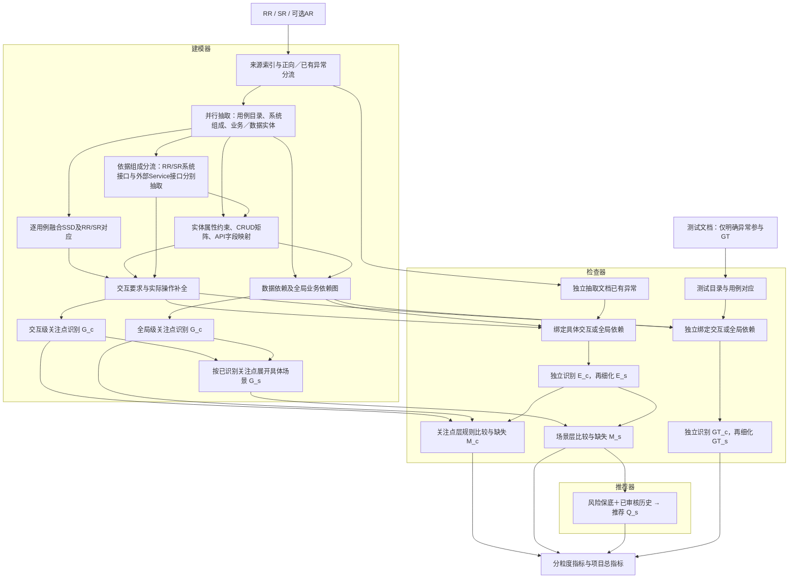

# Scene Completion 场景完整性工作台

从RR、SR与可选AR需求，以及已有结构化文件建立模型，独立识别文档已有异常和测试异常，比较两层覆盖并推荐缺失场景。

当前仅支持 **scene-workflow-v5** 和最新四层关注点体系。旧协议执行、旧关注点迁移及历史推荐算法已移除；旧数据保留在原目录和实施前备份中，不提供旧协议适配。

## 启动

Python 3.12及以上，前端开发使用Node.js 22。运行依赖精确锁定在 `requirements-windows.lock`。

```sh
python -m pip install -r requirements-dev.txt
python serve.py --port 8765 --data-dir .workbench --env-file .env
```

打开 http://127.0.0.1:8765 。服务直接提供已构建的网页，日常使用不需要Node.js。

Windows用户下载 [Releases中的离线包](https://github.com/Yangkailiang1/Scene_Completion/releases)，解压到新目录，双击 `start.cmd`。程序包含Python和全部运行依赖。升级时保留 `data/` 与本地配置，勿用空目录覆盖；只对经过当前Schema、来源及任务规则校验的成功产物复用。原生Windows运行以客户验收记录为准。

## 从目录定位代码

| 目录 | 内容 |
|---|---|
| `src/scene_completion/domain/` | 当前协议、Schema、关注点和场景类型 |
| `src/scene_completion/workflow/` | DAG、共享／逐用例／全局节点、执行、恢复和语义缓存 |
| `src/scene_completion/inputs/` | 文件识别、格式转换、时序引用、采用与追溯 |
| `src/scene_completion/analysis/` | 建模、关注点、场景、比较、推荐和评测 |
| `src/scene_completion/models/` | OpenAI兼容连接、模型路由、流式、限流和用量 |
| `src/scene_completion/review/` | 业务澄清、推荐审核、人工GT和交接 |
| `src/scene_completion/manager/` | 管理Agent、记忆、托管、补丁和质量诊断 |
| `src/scene_completion/api/`、`cli/` | HTTP装配／分组路由与CLI |
| `src/scene_completion/infrastructure/` | 存储、事件、进程与统一资源路径 |
| `frontend/src/app/` | 页面装配与全局状态 |
| `frontend/src/features/` | 按功能组织的页面、状态逻辑和测试 |
| `frontend/src/shared/`、`components/ui/` | 公共请求、类型、工具和基础组件 |
| `.cac/skills/`、`.cac/agents/` | 独立的任务Skill与角色资源，无Python源码 |
| `tests/`、`tools/`、`deployment/` | 离线回归、审计／打包和启动器 |

模块迁移明细见 [代码导览](docs/refactor/code-guide.md)，开发命令见 [开发约定](docs/refactor/development.md)。

## 实际流程



RR/SR接口分别抽取，区分请求、成功响应及各失败响应。外部Service接口依据系统组成和实际调用接收方单独抽取，分别保存RR/SR来源，不靠URL前缀判断内外部。执行图中的`external-api-map`、`external-api-index`、`external-api-parameters`提供独立映射、目录和契约；已验证契约也进入总表和对应交互分析。接口只声明签名认证而没有参数Schema时，保留`interface_constraints`及原文依据，不补造字段、密钥或响应。

融合SSD按最小实际调用建模；同一次请求的重复描述统一身份，独立下游调用保留展开关系。交互级与全局业务依赖级独立定位、去重、展示，再按计数合并项目指标。

G仅读取正向材料；E来自文档已有异常；GT来自明确异常测试。正常、可选和待确认不进入确定集合。关注点由LLM识别，工具根据稳定定位规则比较；已识别关注点再展开细粒度场景。推荐来自M，不能读取当前GT排序。

## 已有文件输入

支持Markdown、JSON及测试XLSX。可使用原始RR/SR/AR，也可接入API提取结果、功能树、恢复用例、结构化需求及行为目录；完整且验证通过的输入跳过相应模型抽取，部分输入只补缺项。

行为目录中 `ssd.json` 是RR外部交互；`operations/*/complete_behavior.json` 是SR完整交互定义；`main_success.json` 仅提供时序引用。结合场景类型及步骤引用分流成功、异常和备选，无法判定的保留待确认并由原流程补齐。不能把不完整的主成功文件当作SR完整定义。

同时支持 `行为模型/<资源>/<用例>/SysOperation.json`、`SSD.json` 和 `behaviour/IR|SR/*.json`：用操作内的 `participant` 恢复全称，按入口、`Order`、最终返回展开。明确的 `action` 保留为本地四元组，同一执行对象的双方关注点只计一次。完整转换通过融合SSD校验后可跳过该模型调用；缺项、悬空引用或数据错误保留原流程补齐。

仓库提供 [五用例mini数据集](datasets/mini-mall/README.md)，用于格式与流程测试；该目录不进入Windows离线程序包。

见 [五类文件接入](docs/five-input-bundle.md)、[行为目录格式](docs/resource-behavior-input.md)、[接口层级与测试范围](docs/recovered-json-and-sr-metrics.md)。

## CLI与管理Agent

```sh
python scene.py capabilities
python scene.py projects
python scene.py status --project PROJECT_ID
python scene.py run --project PROJECT_ID --case CASE_ID
python scene.py diagnose --project PROJECT_ID --task NODE_ID
python scene.py manager --help
```

CLI与网页使用相同项目、DAG、校验和审计。模型配置按连接的可用模型列表管理，账号、并发、路由或显示调整不使成功业务产物整体失效。客户网关合计最多3路请求，未知用量和账号保护线继续生效。

[模型配置与CLI](docs/workbench-cli-model-accounts.md) · [管理Agent](docs/project-manager.md) · [业务离线审核](docs/business-offline-review.md) · [指标诊断](docs/quality-diagnostics.md) · [Windows打包](docs/windows-portable.md)

## 检查与发布

```sh
make check
make frontend-build
python tools/build_windows_bundle.py --output-dir dist/windows-latest --offline
```

`make check`运行Ruff、Python回归、ESLint、严格TypeScript、Prettier和前端测试；不调用付费模型。构建离线包前需已缓存Windows wheels与嵌入式Python。原生Windows与客户网关测试单独记录。

历史设计和验收见 `docs/history/`；它们不是当前业务规则。当前字段以 `domain/schema_definitions.py` 与 [v5 Schema](docs/scene-workflow-v5/schemas/) 为准。
