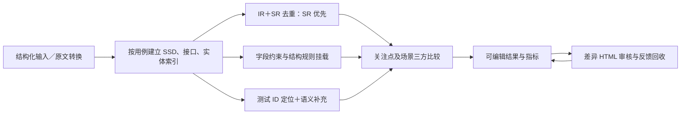

# Scene Completion 场景完整性工作台

以 SSD 的发送方、数据和接收方为统一定位，比较原文已有、方法生成和测试逆向三方异常，支持步骤与结果修正、原始 Markdown 追溯，以及离线差异审核。新主流程说明见 [SSD 工作流与审核](docs/current/ssd-case-workflow.md)。

当前项目协议为 **scene-workflow-v5**，默认结果格式为 **ssd-case-v1**。v2/v3/v4仅保留历史文档；既有详细流程、独立旧格式导入和保存报告分别放在`compat/detailed`、`compat/standalone`、`compat/saved`，用途见[版本与兼容边界](docs/reference/versions.md)。

[当前规则](docs/current/concern-rules.md)说明字段、实体、返回报文与计分边界；v9/v10/v11保留为历史演进和验收记录，不是并行源码版本。关注点漏报率0%不表示全部场景已覆盖，历史报告不冒充新版成绩。完整入口见[文档导航](docs/README.md)。

## 启动

Python 3.12及以上，前端开发使用Node.js 22。运行依赖精确锁定在 `requirements-windows.lock`。

```sh
python -m pip install -r requirements-dev.txt
python serve.py --port 8765 --data-dir .workbench --env-file .env
```

打开 http://127.0.0.1:8765 。服务直接提供已构建的网页，日常使用不需要Node.js。

Windows用户下载 [Releases中的离线包](https://github.com/Yangkailiang1/Scene_Completion/releases)，解压到新目录，双击 `start.cmd`。程序包含Python和全部运行依赖。升级时保留 `data/` 与本地配置，勿用空目录覆盖；只对经过当前Schema、来源及任务规则校验的成功产物复用。原生Windows运行以客户验收记录为准。

上下文预检默认使用包内分词资源。未知网关模型用 `o200k_base` 加余量估算，实际窗口以网关为准。节点的“请求上下文”分别展示字节大小、输入 Token 估计、输出预留与上限；模型设置或 CLI `configure --context-tokenizer` 可覆盖分词方式。额度账本继续按自身预留和供应商返回用量结算。

历史执行路径中的 `business-crud` 从全局实体表选取当前用例有据关联的实体；新 SSD 主流程直接使用用例的接口／实体关联。首轮按证据 ID 引用原文，长引文可分页补取，单次最多 8 条、合计 16 KiB。升级后可定向续跑失败节点，成功缓存经实体范围和依据复核后继续使用。

对于仍使用历史执行路径的独立项目，要试点 CRUD 与接口映射的主动查证，可在项目运行配置中设置 `"agent_evidence_pilot": true`。CLI 可将这个布尔字段放在 JSON 文件中，再用 `configure --config-file` 保存。试点节点可在模型请求期间查询当前用例的实体、交互及接口声明，提交仍使用正式产物校验。

## 从目录定位代码

| 目录 | 内容 |
|---|---|
| `src/scene_completion/application/` | 项目、执行和SSD修订应用服务 |
| `src/scene_completion/domain/` | 当前协议、Schema、关注点，以及SSD校验/匹配/指标 |
| `src/scene_completion/workflow/`、`workflow_core/` | SSD编排、调度适配/恢复，以及通用DAG核心 |
| `src/scene_completion/inputs/` | 结构化材料、文档转换、导入与来源 |
| `src/scene_completion/analysis/` | 按SSD、交互、关注点、场景、匹配和评测分组的计算 |
| `src/scene_completion/compat/` | 详细流程、独立旧格式、保存报告的明确兼容边界 |
| `src/scene_completion/review/` | SSD离线HTML、原业务交接包、人工决定和审核真值 |
| `src/scene_completion/models/`、`manager/` | 模型传输/用量与管理Agent |
| `src/scene_completion/api/`、`cli/`、`infrastructure/` | 公开入口、存储、事件、进程和资源定位 |
| `frontend/src/app/`、`features/` | 页面装配；results分为ssd、saved及共用组件 |
| `frontend/src/shared/`、`components/ui/` | 跨功能请求、类型、工具和基础组件 |
| `.cac/skills/`、`.cac/agents/` | 模型实际加载的Skill与角色资源 |
| `tests/` | unit、integration、contracts、acceptance、portable；共享工具在support |
| `deployment/windows/`、`deployment/experiments/` | 正式Windows模板与历史本机实验脚本 |
| `web/`、`dist/` | 生成的网页和打包产物；不作为源码编辑 |

[架构与依赖图](docs/architecture/code-guide.md) · [开发约定](docs/architecture/development.md) · [唯一迁移清单](docs/architecture/module-map.json)

## 实际流程



结构化用例只注册“建立 SSD 与三方结果、处理语义对应、比较与发布”三个节点，按项目并发限制执行。旧文档先抽取共同用例结构，再进入相同流程。脚本负责结构定位、约束挂载、去重和指标；Agent 只处理未解决的语义项。G/E/GT 独立识别，场景只在同一对象关注点下比较。

数据约束按实际请求、响应及实体字段逐项挂载；非数据关注点保留类型、方向、CRUD、技术类别等适用规则，取消额外的原文证据门槛。IR/SR 同一失败只计一次、优先 SR，保留全部出处。正常、备选和待确认不计分；待确认可以在结果页修正后转为明确异常。

结果页支持修改 SSD 步骤、三方关注点/场景、挂载和匹配。每次保存建立修订并重算，机器基线与人工覆盖分开保存，重跑保留人工修正。点击原文弹窗渲染最初始 RR/SR Markdown，支持章节导航与行高亮。

“导出差异 HTML”只展示不一致条目，内嵌原始 Markdown，可离线查看、修改和保存新的审核文件；回导先预览变更与冲突，再由用户应用。无需 Python 或本地服务。

关注点漏报率、生成有效率沿用当前公式；场景结果作为独立诊断。空分母为不适用，项目按分子分母汇总。本轮不运行全局关注点、全局幂等性及风险推荐排序。旧报告保留；历史 mock 回放默认使用其原任务契约，显式 `workflow_mode=ssd` 可验证新流程。

## 已有文件输入

支持Markdown、JSON及测试XLSX。可使用原始RR/SR/AR，也可接入API提取结果、功能树、恢复用例、结构化需求及行为目录；完整且验证通过的输入跳过相应模型抽取，部分输入只补缺项。

行为目录中 `ssd.json` 是RR外部交互；`operations/*/complete_behavior.json` 是SR完整交互定义；`main_success.json` 仅提供时序引用。结合场景类型及步骤引用分流成功、异常和备选，无法判定的保留待确认并由原流程补齐。不能把不完整的主成功文件当作SR完整定义。

同时支持 `行为模型/<资源>/<用例>/SysOperation.json`、`SSD.json` 和 `behaviour/IR|SR/*.json`：用操作内的 `participant` 恢复全称，按入口、`Order`、最终返回展开。明确的 `action` 保留为本地四元组，同一执行对象的双方关注点只计一次。完整转换通过融合SSD校验后可跳过该模型调用；缺项、悬空引用或数据错误保留原流程补齐。

仓库提供 [五用例mini数据集](datasets/mini-mall/README.md)，用于格式与流程测试；该目录不进入Windows离线程序包。

见 [五类文件接入](docs/current/five-input-bundle.md)、[行为目录格式](docs/current/resource-behavior-input.md)、[接口层级与测试范围](docs/reference/recovered-json-and-sr-metrics.md)。

## Code Agent 单用例独立分析

把输入目录、用例ID和输出目录交给[单用例分析Skill](.cac/skills/scene-case-analysis/SKILL.md)，使用共同SSD流程。脚本处理结构、规则和明确定位，Agent补充未决语义；新流程不经过风险推荐。

```sh
python .cac/skills/scene-case-analysis/scripts/case_analysis.py build \
  --input INPUT_DIRECTORY --case CASE_ID --output OUTPUT_DIRECTORY
python scene.py import-case-result --project PROJECT_ID \
  --file OUTPUT_DIRECTORY/case-analysis.json --dry-run
python scene.py import-case-result --project PROJECT_ID \
  --file OUTPUT_DIRECTORY/case-analysis.json
```

单用例输出`ssd-case-v1`的`case-analysis.json`，导入后在三方结果页查看和修订。仅运行脚本不代表未决语义比较已完成。旧`scene-case-analysis-v1`继续支持校验和导入，保留原三方结果和判定；`schema`、`prepare`、`finalize`用于既有旧格式工件。两种入口和保存结果页面见[独立分析说明](docs/current/standalone-and-saved-results.md)。

## CLI与管理Agent

```sh
python scene.py capabilities
python scene.py projects
python scene.py status --project PROJECT_ID
python scene.py run --project PROJECT_ID --case CASE_ID
python scene.py diagnose --project PROJECT_ID --task NODE_ID
python scene.py manager --help
```

CLI与网页使用相同项目、DAG、校验和审计。模型配置按连接的可用模型列表管理，账号、并发、路由或显示调整不使成功业务产物整体失效。客户网关合计最多3路请求，未知用量和账号保护线继续生效。

[模型配置与CLI](docs/current/workbench-cli-model-accounts.md) · [管理Agent](docs/current/project-manager.md) · [SSD离线审核](docs/current/ssd-case-workflow.md) · [原业务包交接](docs/current/business-offline-review.md) · [指标诊断](docs/current/quality-diagnostics.md) · [Windows打包](docs/current/windows-portable.md)

## 检查与发布

```sh
make check
make frontend-build
python tools/build_windows_bundle.py --output-dir dist/windows-latest --offline
```

`make check`运行Ruff、Python回归、ESLint、严格TypeScript、Prettier和前端测试；不调用付费模型。构建离线包前需已缓存Windows wheels与嵌入式Python。原生Windows与客户网关测试单独记录。

历史设计和验收见 `docs/history/`；它们不是当前业务规则。当前字段以 `domain/schema_definitions.py`、`domain/ssd/` 与 [v5 Schema](docs/scene-workflow-v5/schemas) 为准。
