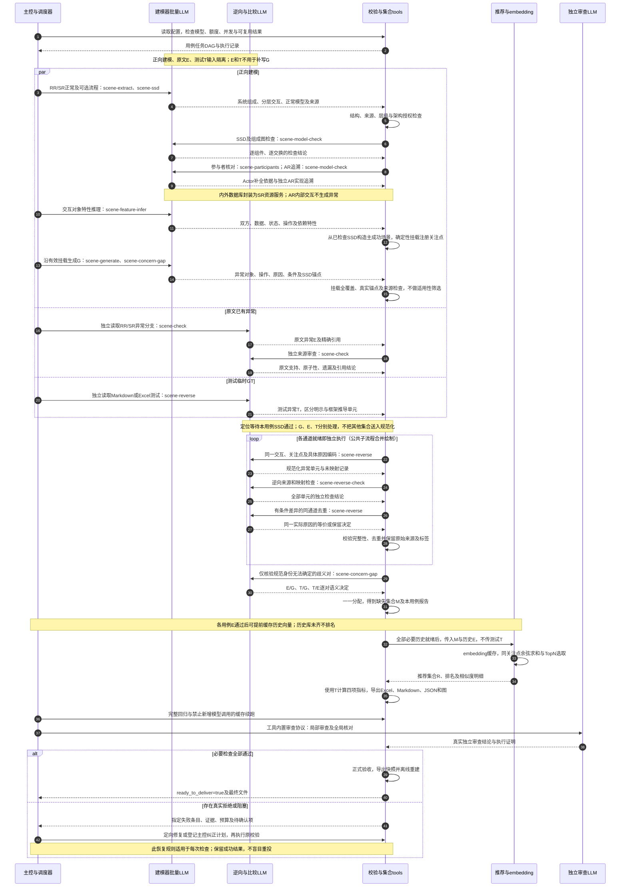

# Scene Completion

从分层需求、系统架构和交互序列图识别异常关注点，逆向统一原文已有异常并推荐缺失场景。默认协议为`rr-sr-concern-gap-v2`；Skills定义方法，tools负责批次、结构校验、规范化集合、一一对应和导出。

## 工作流程

1. 读取RR系统需求、SR设计spec及AR材料。IR视为RR；未单独提供AR文件时，从SR文档中的AR描述保留实现追溯。
2. 语义抽取正常/普通可选流程、系统组成与原文已有异常。两个输出通道独立，已有异常不进入建模器。
3. 检查融合SSD和系统组成图，再从SSD构造主成功场景、从正向组成与交互推理对象特性。保留RR请求、SR展开及逐层返回；AR不参与异常挂载，内外数据库封装为SR资源服务。
4. 根据主成功交互和对象/数据/依赖特性挂载注册关注点，生成原子异常G；不进行异常适用性筛选。
5. 独立逆向已有异常E和测试异常T，统一到用例、实际交互、关注点、具体原因及必要条件，经过逆向检查器。宽泛异常测试拆成不同因果触发单元，并标记框架推导；正常条目不展开异常。
6. 各通道先复核同一交互、对象、原因下的条件差异：普通操作前提的不同描述可合并为同一异常，额外因果条件必须分开；保留全部原条件和标签。再按规范化身份及同交互/关注点内的语义核验一一对应，形成缺失集合M=G−E；未映射异常单列，不删除或强行分类。
7. M中的每条候选与同关注点的全部唯一历史E做embedding，原始余弦相似度求和。每类少于10条全选，否则选min(N,max(10,ceil(10%×N)))；无历史时固定种子随机取最多10条。跨类选中异常去重形成R，全部M仍在缺失报告中保留。
8. 以客户测试spec作为临时GT，计算漏报率、生成有效率、推荐采纳率及推荐误报率，分别提供总计、关注点和大类结果；输出JSON、Markdown、Excel及图。

匹配只比较异常对象、操作、机制及必要条件，响应和恢复不参与。测试GT不进入建模器或历史embedding库。正常模型来源检查不是异常候选筛选。

完整和部分匹配均可参与一一分配及集合交集计数；部分匹配必须识别同一具体原因，并提供缺少的必要条件原句。普通主题相同不算部分匹配，全部逐对决定保留供检查。

重复请求、回调或事件的幂等重放按异常触发条件处理，即使正确预期是复用已有结果且不重复执行；不能因为处理成功便改成普通可选流程。普通取消或正常选择仍保留为可选。

### Skills 全流程时序图

下图描述默认 `case-dag` 编排。`par` 表示输入独立、允许并行，不要求一定同时调用模型；实际并发、模型和预算来自配置。每个用例依赖通过即可继续，其他用例的失败不阻塞它。为便于阅读，G/E/T的公共逆向子流程只画一次；实际按各通道依赖就绪分别执行，不等待三个通道一起完成，比较才等待关联集合完整。



### 阶段、Skill 与检查职责

“批量”指请求包实际加载的 Skill；“主控指导”指宿主按阶段读取的方法说明，不表示另一次模型调用。纯工具计算不会为了对应 Skill 名称而额外调用 LLM。

| 阶段 | 输入 → 输出 | Skill 或执行方式 | 主要检查 | 失败去向 |
| --- | --- | --- | --- | --- |
| 预检与编排 | 文档、配置、已有运行 → 来源索引、可执行任务及缓存状态 | 主控指导：[scene-controller](.cac/skills/scene-controller/SKILL.md)、[scene-concern-gap](.cac/skills/scene-concern-gap/SKILL.md)；模型探测及DAG由tools执行 | 实际可访问模型、上下文、共享并发、预算、输入版本及执行身份；Excel/Markdown读取 | 配置或额度待处理；有效缓存继续检查，不重置账本 |
| 正常交互抽取 | RR/SR正常及普通可选流程、正向契约 → 分层模型及融合SSD | 批量：[scene-extract](.cac/skills/scene-extract/SKILL.md)、[scene-ssd](.cac/skills/scene-ssd/SKILL.md)及其输入规范；tools构图 | 用例分解、请求/逐层返回、字段、真实来源、数据库SR服务化；禁止读取E/T | 定向修复正常模型；新增组件、调用或原文修订先确认 |
| SSD、组成与AR检查 | 正常模型、SSD、原文 → 图检查及实现追溯 | 批量：[scene-model-check](.cac/skills/scene-model-check/SKILL.md) | 组件身份、内外属性、交换顺序、父子展开、来源；AR仅追溯 | 修复对应模型或待确认；已通过共享组件按版本复用 |
| 参与者补全检查 | 正常调用、架构角色、原Actor列表 → 核对结论 | 批量：[scene-participants](.cac/skills/scene-participants/SKILL.md) | 原文实际调用是否漏写Actor；架构成员身份不能凭空证明调用 | 回到正常模型，保留有依据的参与者；新增调用先确认 |
| 交互特性推理 | 已检查图、正常交互 → 身份、职责、数据及依赖特性 | 批量：[scene-feature-infer](.cac/skills/scene-feature-infer/SKILL.md) | 明示与推断分开、逐特性引用；未知限制待确认，不能继承其他交互的操作能力 | 修复实际拒绝的特性，不重做成功交互 |
| 主成功与关注点挂载 | 已检查SSD、特性、注册关注点 → 主成功/可选场景与挂载清单 | 确定性tools；主控方法参考：[scene-generate](.cac/skills/scene-generate/SKILL.md) | 主成功步骤来自SSD消息顺序；关注点绑定真实同层交换、对象与数据，保留挂载理由 | 模型、特性或挂载缺口；未确认的新关注点不得加入 |
| 异常G具体化 | 有效挂载及其正向证据 → 全部生成异常G | 实际批量：[scene-generate](.cac/skills/scene-generate/SKILL.md)（generator_skill）及[scene-concern-gap](.cac/skills/scene-concern-gap/SKILL.md)（skill） | 每个有效挂载均有候选；对象、原因、条件、来源和SSD锚点有效；不虚构阈值，不做适用性删除 | 只修复拒绝挂载的产物；不得从E或T补写G |
| 原文E抽取与审查 | RR/SR原文异常分支 → 已有异常及独立来源审查 | 抽取和审查包均携带：[scene-check](.cac/skills/scene-check/SKILL.md) | 明示/泛指异常结合明确契约的依据、原子拆分、操作绑定、遗漏及引用；普通前置条件不冒充异常 | 原通道定向补抽或修复；不能参考G/T改分母 |
| 测试T抽取 | Markdown/Excel测试 → 临时GT，保留明示/推导标记 | v2实际批量：[scene-reverse](.cac/skills/scene-reverse/SKILL.md)；测试方法参考：[test-scenario-extract](.cac/skills/test-scenario-extract/SKILL.md) | 读取前提、步骤、预期、对应需求及编号；正常流程不变异常，幂等触发单独处理 | 只依据测试原文及允许的框架推导修复，禁止读取G或推荐 |
| G/E/T规范化 | 各自场景及已检查交互 → 原子因果单元、未映射记录 | 各通道独立批量：scene-reverse | 交互、对象、原因及必要条件完整；G已有识别字段与挂载由tools保持不可变 | 修复本通道失败单元；未映射保留，不能强行匹配 |
| 逆向检查与同通道去重 | 各通道规范单元、来源 → 检查结论及唯一单元 | 批量：[scene-reverse-check](.cac/skills/scene-reverse-check/SKILL.md)；条件差异去重批量：scene-reverse；合并由tools执行 | 来源、原子性、映射、原因、条件等价及全ID覆盖；不同实际原因不合并 | 修复源场景或规范化结果，再复检；不能删掉拒绝记录来通过 |
| 对应与缺失检查 | 已检查G/E/T → E/G、T/G、T/E决定和M | 规范身份确定性比较；歧义对批量：scene-concern-gap；一一分配由tools执行 | 同一实际交互、对象、原因和必要条件；响应/恢复不参与；不得多对多占用 | 仅修复失败比较对或上游实际错误；不降低匹配标准 |
| 历史推荐 | 全部就绪的历史E及M → 向量、相似度、每类排名及R | 主控指导：[scene-history-recommend](.cac/skills/scene-history-recommend/SKILL.md)；embedding API及确定性排名tools | 历史来源、向量端点/模型/文本版本、同类全部历史求和、TopN及固定种子；T不进入排序 | 缺失或过期向量按需补齐；历史未齐只缓存，不发布排名 |
| 指标与报告 | G/E/T、对应、M/R → 总计及分类指标、全部报告和图 | 确定性tools；主控指导：scene-concern-gap | 一一对应去重、四项公式、空分母、分类标签、输入完整性及章节定位 | 未完成部分保留为进行中，不能作为全项目正式指标 |
| 验收与交付 | 完整产物、执行证明 → 验收结果及离线快照 | 主控指导：scene-controller；回归/续跑/重建为tools；独立LLM使用工具内置审查协议，**不直接加载scene-review** | 真实回归、零新增调用、独立局部及全局审查、材料/模型身份绑定、离线一致性和文件齐全 | 真实缺陷定向修复；审查误判须绑定原结论重新独立复核；只有ready_to_deliver=true正式交付 |

默认自动修复最多两轮，计数随续跑保留。配置的首次主控接手仍失败后，主控先定位通用工具或提示词问题；需要新语义调用时登记绑定当前失败及纠正依据的新计划。相同失败且没有新依据不得反复提交。新组件、调用边、关注点或原始文档修改继续先确认；成功任务及无关用例保持有效。宿主主控的指导 Skill 与批量模型配置相互独立，不在提示词中固定具体模型。

## 安装

使用Python 3.11或更新版本，在项目根目录运行：

```bash
python -m pip install -r requirements.txt
```

需要运行回归时另安装pytest：

```bash
python -m pip install pytest
```

Claude Code 的项目入口见 [CLAUDE.md](CLAUDE.md)，按当前阶段读取 `.cac/skills` 并运行已有 tools。主控模型与工具批量模型分别配置，共享并发由一个调度器管理。WSL 使用 Linux 的 Python/Conda 环境及依赖；同一工作区跨 Windows/WSL 时，先核对 Git 的换行和文件权限设置，避免把环境差异当成源码改动。同一运行目录只能由一个环境中的调度器推进。

## 准备输入与配置

| 输入 | 用途 |
| --- | --- |
| `--model` | 项目的用例编号、原文定位及系统身份种子，参考 `examples/online_shopping_seed.json` |
| `--rr-spec-document` | 原始RR需求，可重复指定；IR映射为RR |
| `--sr-spec-document` | 原始SR设计，可重复指定；AR描述只提供追溯 |
| `--test-spec-document` | 独立测试spec，可重复指定；经逆向细粒度化形成临时GT |
| `--ar-spec-document` | 可选独立AR材料，可重复指定；仅架构追溯，不分析AR交互 |
| `--output-dir` | 当前运行目录，保存状态、批次、执行记录及输出 |

默认使用Agent抽取、检查和语义核验，推荐使用历史embedding排序。模型名由配置决定，批量入口、修复、执行证明及验收不限定为固定模型列表。可选择`ecnu-max`、`qwen38-27b-vl`或端点实际提供的其他模型；Luna原生子进程也按配置选择模型。模型请求名和接口返回的提供方名称分别记录，不静默换模型。

通用配置参考 [model.config.example.json](model.config.example.json)：在本地`.env`或环境变量设置`SCENE_API_BASE_URL`、`SCENE_API_KEY`、`SCENE_AGENT_MODEL`及`SCENE_EMBEDDING_MODEL`。模型选择优先级为命令行覆盖 → 配置文件中的模型名/环境变量引用 → `SCENE_*_MODEL` → 兼容的ECNU环境变量。ECNU示例 [rr_sr.config.example.json](rr_sr.config.example.json)继续支持`ECNU_MAX_BASE_URL`、`ECNU_MAX_API_KEY`、`ECNU_MAX_MODEL`及`ECNU_EMBEDDING_TEXT`。不提交密钥及运行缓存。

也可使用本地Luna子进程：先完成Codex CLI安装和登录，配置参考 [luna.config.example.json](luna.config.example.json)，增加 `--agent-runtime luna-subprocess`。模型及推理设置以本地运行配置为准，独立效果审查可用`review_model`、`review_runtime`及`review_reasoning_effort`单独选择；实际身份保存在执行记录中。Luna子进程只处理语义包，历史推荐调用配置的embedding API；可用 `--embedding-config <config.json>`提供独立embedding地址/密钥环境变量/模型配置。

Qwen的OpenAI兼容接口示例见 [qwen.config.example.json](qwen.config.example.json)，使用你指定的`qwen38-27b-vl`。该示例沿用ECNU地址与密钥环境变量，也可修改为其他提供方。批量命令可直接增加`--agent-model qwen38-27b-vl --embedding-model <向量模型ID>`；pipeline、worker和修复命令均支持模型覆盖。`--agent-runtime openai-compatible`是通用API入口，原`ecnu`名称保留兼容；Qwen使用API入口，Luna子进程只能调用本地CLI实际支持的模型。

百炼配置参考 [bailian.config.example.json](bailian.config.example.json)，分别设置`BAILIAN_BASE_URL`、`DASHSCOPE_API_KEY`和`BAILIAN_MODEL`；凭证变量名可通过`api_key_env`修改。`thinking_api=enable_thinking`使用提供方的思考开关，关闭时也显式传false；`reasoning_effort`按提供方支持的档位配置。流式请求可用`include_usage=true`要求返回实际用量。语义和embedding使用不同提供方时，增加`--embedding-config <独立配置>`，不会把语义凭证发送到embedding端点。

提供方只接受思考token上限时，配置`send_reasoning_effort=false`，再设置正整数`thinking_budget`；不同时发送两种推理参数。实际请求参数写入执行证明，不能把不同设置的缓存重新标成当前执行。

用例级编排可配置有序的`batch_fallback_configs`文件路径列表。真实额度不足时按顺序切换；明确不可访问的备用模型保留探测拒绝并继续下一个已配置模型。默认429、断连、格式、引用或语义失败不触发额度切换；未知用量默认停止后续调用。配置化的超时接手及保守续跑规则见下文。各模型使用独立持久账本，`batch_model_state.json`保留切换历史和实际当前模型；续跑不返回已耗尽模型，不改写成功结果身份。

需要经授权提前转至已配置的备用模型时，设置`batch_preferred_profile_index`及非空的`batch_profile_selection_reason`，仅支持向前切换。初次执行因额度阻塞、尚无任务级语义失败的任务可继续原批次；已有修复计划及语义失败仍按定向修复处理。成功包与各模型原账本保持不变；混合模型运行不能作为单模型独立能力证明。

需要超时接手时，对相应配置显式开启`timeout_handoff=true`，把接手配置追加到模型链；超时或断连保留失败证明后转交下一配置，不重发原请求。未知用量默认停止；显式`unknown_usage_policy=reserve_and_continue`保留全部预留占额，再按剩余额度决定是否允许新调用。同一提供方账户须设置一致的`provider_token_budget_limit`、`provider_token_budget_ledgers`及`provider_token_budget_lock`，跨模型核算已用、在途和未知占额；更换模型不能重置账本。仅追加备用配置可保留原路由历史。

模型能力筛选用`scene_model_benchmark.py --source-run <已有运行> --config <候选配置> --output-dir <本地对比目录>`；同一角色原包、证据和校验器在不同模型间保持一致，默认首次执行后最多两次定向补抽，成功不重跑。输出分别标注独立通过、补抽通过、无法访问、传输或额度停止。无访问权限不能计作模型能力失败；模型总参数与MoE激活参数分别记录，不由参数量直接推断可用性。

需要限制一次实验的语义API总量时，在本地配置设置`token_budget_limit`和`token_budget_ledger`。调用前为输入UTF-8字节代理及输出上限预留额度，并发共享持久账本；接口返回后按实际总tokens结算。若提供方的输出上限不包含思考tokens，另配置`token_budget_reasoning_reserve`预留该档位的思考上限。用量未知时保守保留预留额度，按上述未知用量策略决定是否继续；预算模式每个请求只发一次HTTP，不作隐式传输重投。续跑保留账本和限额，不换账本重置已用量；缓存命中不扣API预算。该本地保护不代替提供方账户余额或计费查询，其他程序使用同一凭证时须另行计入。

华师`ecnu-plus`配置见[ecnu_plus.config.example.json](ecnu_plus.config.example.json)。提供方的思考档位可能随模型不同，使用配置中的实际`reasoning_effort`及可选`supported_reasoning_efforts`，不要直接照搬另一模型。华师plus的`medium`对应界面“高”，支持`low/medium/xhigh`，详见[官方思考模式说明](https://developer.ecnu.edu.cn/vitepress/llm/thinking.html)。示例按客户容量设置`max_context_tokens=200000`；这是本地限制，不自动套用平台更大的标称上限。发送前保守估算输入与输出预留，超限要求拆包，不截断证据。

长响应可配置`stream=true`使用兼容API的SSE传输，记录首事件延迟并在内存组装最终JSON；只有收到结束标记与完成原因、通过原结构及来源校验后才接受结果。断流或不完整JSON保持待处理，不保存思维链或把部分输出改为通过；未返回用量时仍标为未知。配置示例启用流式传输，实际支持情况通过同设置的模型预检确认。

embedding也可使用 [embedding.config.example.json](embedding.config.example.json)，独立设置`SCENE_EMBEDDING_BASE_URL`、`SCENE_EMBEDDING_API_KEY`和`SCENE_EMBEDDING_MODEL`，通过`--embedding-config`加载；`--embedding-model`优先于该文件。向量缓存按端点、模型和文本隔离；改换模型或端点会计算对应向量。旧向量缓存不迁移成新模型结果。

### 检查可用模型与设置并发

先串行探测当前配置的模型，再选择检查通过的模型写入本地运行配置：

```bash
python .cac/tools/scene_completion.py check-models --config model.config.example.json --include-embedding --output-dir output/model-check
python .cac/tools/scene_completion.py configure-models --config model.config.example.json --checked-report output/model-check/available_models.json --agent-model <已通过的模型ID> --max-concurrency 1 --output-config output/runtime.json
```

`check-models`可重复指定`--candidate-model <ID>`检查其他语义模型，`--discover`可读取端点目录；目录中列出不代表可调用。`--include-review`检查配置的独立审查模型，`--include-embedding --embedding-config <配置>`可检查独立向量端点。`configure-models`支持`--embedding-model`、`--review-model`；独立向量配置通过`--embedding-config`及`--output-embedding-config`另存，流程使用两个输出配置。

所有运行、worker及修复入口支持`--max-concurrency <正整数>`，优先于配置中的`max_concurrency`及环境变量`SCENE_MAX_CONCURRENCY`。默认1；Agent应根据客户限制和限流记录调整共享上限，不能每个用例另设一份并发。默认`adaptive_concurrency=true`，DAG遇限流自动减半至至少1，写入`concurrency_status.json`并在同一上限续跑时复用。成功请求不自动提高并发。

新调用前默认执行`model_preflight=auto`检查；有效成功结果续跑不额外探测。拒绝记录按模型、地址、凭证指纹和执行设置隔离，进入待配置后停止同配置的重复请求，不计入语义修复轮数。默认成功记录900秒、拒绝记录300秒，可用`availability_ttl_seconds`设置；权限或额度已恢复时用`check-models --refresh`重检。不会静默换模型或修改历史执行身份。详细操作见 [模型可用性与并发配置](.cac/skills/scene-concern-gap/references/model_access.md)。

## 运行全流程

下面以商城输入说明命令；迁移项目时替换种子和原始文档：

```bash
python .cac/tools/scene_completion.py scene-pipeline --model examples/online_shopping_seed.json --rr-spec-document 在线商城购物系统/系统需求_spec.md --sr-spec-document 在线商城购物系统/功能设计_spec.md --test-spec-document 在线商城购物系统/test_spec.md --agent-mode external --config output/runtime.json --output-dir output/run
```

Luna运行时改用 `--agent-runtime luna-subprocess --config luna.config.example.json`。`--agent-mode packets`只准备和收集语义包，不主动调用模型。`--requirement-document`、`--design-document`分别兼容映射RR、SR。

首次运行可能因缺少架构确认而暂停，检查对应 `cases/<稳定ID>/architecture_proposals.json/md`（阶段兼容模式在根目录）。DAG提案给出 `approval_fingerprint`；批准文件的 `proposal_bindings`记录“提案ID → 指纹”，通过 `--architecture-approval <approval.json>`续跑。历史整图批准只在原模型哈希有效时迁移。补全架构须有原文依据；不为通过检查虚构组件、接口或调用。

默认处理全部用例、全部有效挂载。v2始终核验实际SSD/组成图的原文锚点，错误锚点阻断流程；完整性遗漏与未知契约作为质量诊断保留，不能把流程跑通视为源文完整。执行失败及未完成批次不视为未匹配。

## 续跑与局部运行

v2 默认使用 `--execution-mode case-dag`：每个用例通过自己的 SSD、组件和参与者检查后立即进入特性推理、挂载和异常生成，其他用例的失败不阻塞它。系统组成检查按实际组件及来源版本复用；确认绑定具体提案和证据，不绑定整张不断扩展的模型。`--execution-mode stage-barrier`保留原阶段编排。

调度配置参考 [case_dag.config.example.json](case_dag.config.example.json)，命令行的编排模式、修复开关及轮数优先于配置；未指定时采用配置及上述默认值。`max_concurrency`在调度器和外部调用层统一限制，DAG内部不再使用嵌套语义重试扩大两轮预算。

`--auto-repair bounded`默认启用，每用例、每阶段最多两轮，`--max-repair-rounds 0|1|2`可降低预算；`--auto-repair off`关闭自动修复。格式或引用错误定向修复；模型问题只重看本通道允许的原文；检查器误判先记录原文复核依据，再执行新检查。原文冲突、证据不足及新组件/调用/关注点进入待确认，不会被改标通过。同样失败且无进展提前停止，续跑不会重置已用预算。网络传输重试独立于语义修复预算。

运行目录中的 `case_tasks.json`记录依赖、版本、执行证明及修复次数，`cases/<稳定目录ID>/case_identity.json`对应原用例编号；局部产物和报告分别保存在各用例目录。`progress.json/md`及`component_checks.json`分别显示用例推进状态和组件检查结果。输入修复只使依赖它的下游结果过期，其他成功用例继续复用。

已有异常通过逆向检查和去重后，立即按同类历史计算并缓存向量。完整历史库就绪前不发布推荐分数、TopN或正式推荐指标；成功用例可先查看生成、已有、匹配及缺失报告。未完成用例不计入漏报分母，局部报告明确标为用例范围。全局并发由`--max-concurrency`或配置控制，默认1，包含检查、诊断、修复和embedding调用；额度耗尽后仍可处理已缓存结果。

使用相同输入、配置和输出目录再次执行原命令，即可复用版本有效的成功批次。模型、Skill、规则或相关输入变化使对应结果过期，不能重标旧模型身份。

### 测量阶段耗时

默认 v2 用例编排支持`--profile`，在运行目录单独保存`performance_events.jsonl`、`performance.json`及`performance.md`。记录任务排队、执行、修复、校验、API耗时、请求/响应字节、实际返回的token用量和传输重试次数；未知用量不按零处理。每次续跑形成独立计时会话，缓存复用单列。任务、请求和校验存在嵌套，不能直接相加作为总墙钟时间；同时提供任务重叠时间和基于实际任务耗时的依赖路径。

发送前被本地预算保护阻止的请求单列，不计为未知的提供方用量；已发出但未返回用量的请求继续保守占额。引用错误包含具体条目及字段路径，便于定向修复；参与者检查可选本包证据ID恢复原句，不能绕过原校验器。

测量一个完整用例时，使用新的输出目录并选择`--use-case-id <ID>`。可加`--history-run <已完成v2运行>`仅复用其他用例的历史E及同端点、同模型、同文本向量；当前用例的新E替换旧E。工具先核验原文版本、独立抽取、逆向检查和执行身份，历史不兼容则明确停止，不自动重跑全项目。历史库不进入建模或测试GT；所选用例的旧正常模型、生成异常及测试结果不会由此复用。

在默认用例编排中，历史材料核验和向量复用由独立的`history-import`任务完成。导入失败只阻止最终历史排序和正式指标发布，正常建模、SSD、当前用例的G/E/T仍可推进；同目录续跑只恢复待处理任务。历史引用兼容Windows和POSIX相对路径分隔符，继续核对原执行及文件哈希；不改写旧证据、不通过文件名猜测迁移位置，拒绝绝对路径和越界引用。

计时数据不写入语义包或执行身份；是否启用计时不改变缓存键。只有新目录且未指定语义结果复用才是完整新跑测量；缓存续跑耗时应单独报告。实验性能数据保留本地，具体操作见[阶段性能测量](.cac/skills/scene-concern-gap/references/performance.md)。

可用只读汇总工具合并运行遥测、多个额度账本和选定主控会话的代理日志：

```bash
python .cac/tools/scene_completion.py experiment-usage --run-dir output/run --ledger output/token_budget.json --output-dir output/usage
```

可重复传入 `--ledger`，主控日志通过 `--controller-db` 和重复的 `--controller-session` 明确选择会话。报告按阶段、执行/修复角色及实际模型列出请求数、输入/输出 tokens 和 API 耗时；账本占额、运行遥测、主控用量分别报告，不能重复相加。未知用量保留占额，API 耗时也不能直接当作总墙钟时间。

### 候选模型验证

候选筛选和完整交付分开验证：先用当前校验器检查固定上游难例，再让候选从原始文档独立运行完整用例。筛选范围可用重复的`--task`选择；同一筛选目录不得更换范围、模型身份或原预算账本。

```bash
python .cac/tools/scene_model_benchmark.py --source-run output/reference --config candidate.json --output-dir output/screening --screen-token-limit 150000
python .cac/tools/scene_trial_status.py --run-dir output/run --candidate-model configured-model --verify --output-file output/trial.json
```

筛选增量额度计入模型原账本，未知用量按原占额保留。候选独立配置禁用跨模型fallback和语义supervisor；主控补全时保留独立失败记录并单列真实执行身份及成本。只有正式交付检查通过且所有当前用例语义执行属于候选，工具才标记独立合格；固定独立审查员及其他用例历史库不算候选代写。

筛选用于节省实验成本，也可按任务配置直接验证完整用例；筛选停止不重置总额度。正常模型的局部来源错误采用绑定原执行的条目修复，合并后仍运行完整原校验，避免为一条引用重写整个模型。

生成请求通过带内容哈希的共享表复用重复特性证据，工具解码后执行同一校验；缓存复用比较完整还原的输入和原业务指令。模型按挂载ID返回完整场景集合时，可使用无歧义的格式视图读取，缺失或额外挂载仍拒绝。

API配置可用`stage_max_tokens`设置阶段输出额度，例如`{"gap-diagnosis":3000,"gap-ambiguity-*":4000}`；精确阶段优先，其余选最具体的模式，歧义拒绝。配置显式关闭思考时发送对应接口的关闭参数，不能将参数缺省当成已关闭。证据ID由工具限定在本包、本对象和原始引用范围内，恢复原句后仍执行原校验器。详见[模型试验](.cac/skills/scene-controller/references/model_trials.md)。

429触发共享冷却并降低实际并发；即使并发已为1，也遵守Retry-After，不让其他就绪任务立即继续冲击接口。504、超时和断连保留为传输待处理，不盲目重复提交可能已经开始推理的同一请求。诊断协议有独立的最多两次格式尝试；引用可选择工具给出的逐字引句ID，失败进入`diagnosis_blocked`，保留原失败对象和预留轮次，不通过反复重生成上游来弥补诊断格式错误。

### 上下文减量与离线检查

新建case-dag运行默认采用`context_profile: "compact-v1"`；未声明方案的旧运行继续使用`legacy`。完整原包仍保存并交给原校验器，模型请求将重复材料合为一份可读正文，以包内引用关联。G生成只加载Skill中标记的具体化规则；G/E/T的来源隔离、全部有效挂载及独立检查保持约束。来源检查不用于删除异常候选。

可在批量配置中增加`stage_request_bytes`，如`{"gap-normalize-*":120000,"gap-reverse-check-*":160000}`。精确阶段优先，其余选择最具体通配符；超限按分配条目拆包，单条仍过大则报错，不截断原文。每包的`context_metrics/`记录原始/发送视图字节、覆盖ID与UTF-8字节上界估算；真实tokens以接口usage为准。改变方案会产生新的包身份，不能把旧执行证明重标为新方案。

独立审查配置支持`review_projection_profile: "case-closure-v1"`：因果审查读取当前用例、未知归属及显式跨用例依赖，历史排名保留完整历史库。已有旧审查默认按原投影核验。证据ID恢复、无损格式恢复和原包校验不等于语义通过；结构化错误可直接进入失败字段修复，语义歧义仍需诊断。规范化局部补丁保留原成功条目及执行证明，再用原完整包复验。

主控用`python .cac/tools/scene_workflow_status.py --run-dir <run> --wait-seconds 60 --since-state <上次state_fingerprint>`等待变化；无变化返回紧凑状态，历史拒绝不会将成功任务改为失败。最终收尾仅在一次调用内复用内容哈希绑定的验证结果，`cache_resume`、当前回归和真实独立审查仍执行；本地分项耗时记录在`local_performance.jsonl`。

来源覆盖、共享值往返、错误证据、局部修复、缓存失效与历史排名使用离线测试验证。旧输出复验不能证明新提示词的模型效果；实际token节省和模型速度需要另行授权的定向验证。现有embedding缓存与同类全部历史相似度求和继续使用，未增加向量数据库或近邻TopK替代。详见[上下文与执行效率](.cac/skills/scene-concern-gap/references/context_efficiency.md)。

### Excel或Markdown测试spec

`--test-spec-document`可读取Markdown、`.xlsx`或`.xlsm`，多个文件可重复指定。Excel与Markdown共用用例编号、用例名称、前提条件、测试步骤、预期结果、对应需求六类字段；可附场景类型及原始来源。示例见[test_spec.example.xlsx](examples/test_spec.example.xlsx)及[同内容Markdown](examples/test_spec.example.md)。兼容原Markdown的前置条件、关联需求及九列表格。

在全流程命令中将测试参数替换为`--test-spec-document examples/test_spec.example.xlsx --use-case-id UCG-004-UC001`即可使用该Excel示例。不要同时提交同一份测试的不同版本；跨文件同编号且内容完全一致时合并来源，内容冲突则报出编号，避免重复计数或覆盖原文。

没有类型列时不按关键词猜测正常或异常，保留未标注状态交由独立测试抽取；普通正常操作不会展开假设异常。Excel保留工作表、行/单元格和展开文本行号，多行步骤保留。公式字段需先转明确值，旧`.xls`需另存为`.xlsx`；没有测试表的文件或重复编号会明确报错。测试原文仅进入测试GT通道。

可先离线验证客户文件：`extract-test-scenarios --input <测试.xlsx或.md> --output <解析.json>`，再执行`validate-test-scenarios --input <解析.json>`。这两步只检查结构和来源，不调用模型，也不产生测试异常覆盖结论。

- `--checker-input <已核实运行>/existing_scenarios.json`：在来源和抽取规则一致时复用独立检查器基线。
- `--use-case-id <ID>`：显式选择用例，可重复指定；默认不限制。
- `--reuse-run <run-dir>`：只复用输入包与实际执行证明一致的成功抽取；旧匹配和评分不作为新版结果。
- `--recommendation-seed <整数>`：无同类历史时的固定随机抽样种子，默认42。
- `--source-quality-gate`：旧v1协议的额外正常模型来源审查门禁，默认`strict`；`structural`限显式代表范围。v2保留此兼容配置记录，图锚点检查及质量诊断不由该选项切换。

逆向检查发现生成条目本身的原子原因或操作位置错误时，可执行 `repair-gap-generation --output-dir <run-dir> --config <config.json>`，用 `--unit-id <ID>`指定被实际拒绝的单元。修复只读取该生成条目、原关注点挂载及正常SSD证据，保留拒绝执行和替换执行；不使用已有异常或测试GT，不重生成其他成功条目。修复完成后再次执行原流程命令。

来源审查引文只允许校正Markdown行首缩进，保存原始引文及精确原句，正文、标点、顺序和内部空白仍须一致。已有v2运行因这一格式问题停止时，可执行`revalidate-source-audit-format --output-dir <run-dir> --use-case-id <ID>`离线复检：原执行身份和修复计数保留，原校验器通过后才继续，不调用模型或改变语义拒绝结论。其他错误继续使用正常诊断修复入口。

图检查可将原输入中唯一的局部交互编号解析为完整ID，保留原编号；歧义、重复、未知编号或缺项仍会拒绝。旧运行可用`revalidate-graph-format --output-dir <run-dir> --use-case-id <ID>`离线复检。工具版本变化但语义输入、指令及输出契约未变时，成功任务可在当前校验器复核后沿用原执行；共享组件从输入移入检查缓存不构成新交互。需要显式复检过期成功任务时，使用`revalidate-cached-task --output-dir <run-dir> --use-case-id <ID> --stage <阶段>`。这些入口均不调用模型、不重置修复预算；真实输入或语义判断改变则不能复用。

`revalidate-cached-task --stage all`按依赖顺序离线复检曾经成功的任务，返回复用、不兼容及待执行清单。它不会替未完成任务补写结果。历史向量仅在当前模型、端点、文本及缓存完全一致时复用；需要新的外部计算时明确停止。

检查工具更新后，可用`refresh-task-diagnostics --output-dir <run-dir> --use-case-id <ID> --stage <阶段>`从原失败执行重新收集具体错误，不调用模型或改判通过。若先前因“相同错误无进展”提前停止，且新诊断确有变化并仍有剩余轮次，可继续原预算；已用满两轮不会重新开放。

已有异常或测试的逆向定位/拆分被检查器拒绝时，使用 `repair-gap-reverse --output-dir <run-dir> --collection E --unit-id <ID> --config <config.json>`；测试通道改为 `--collection T`。只修复同通道的实际拒绝单元，原始异常记录保持不变，随后重新检查。

## 检查、验证与导出

```bash
python .cac/tools/scene_completion.py check-interaction-run --output-dir output/run
python .cac/tools/scene_completion.py validate-interaction-run --output-dir output/run
python .cac/tools/scene_completion.py prepare-interaction-review --output-dir output/run
```

完成真实独立效果审查并保存绑定当前材料的原始结论后运行：

```bash
python .cac/tools/scene_completion.py evaluate-modeling --output-dir output/run
```

`check-interaction-run`可检查部分运行，输出 `run_checks.json/md`。`validate-interaction-run`执行完整回归及禁止新模型调用的缓存续跑。流程完成、输入质量和覆盖效果分别报告，不能仅凭 `complete=true`宣告验收。

Claude Code等宿主的持续编排与最终交付见[主控Skill](.cac/skills/scene-controller/SKILL.md)。`python .cac/tools/scene_workflow_status.py --run-dir <run> --wait-seconds 60`提供紧凑任务交接，不启动模型或第二个执行器；可传执行器状态文件和各提供方额度账本。计算完成后仍需回归、零调用续跑、真实独立审查和离线重建；执行器停止后加`--verify`核对验收绑定及交付文件，只有`ready_to_deliver=true`才声明正式交付。尚未交付时退出码2只是状态，不是重跑成功阶段的理由。

宿主会清理随对话启动的后台进程时，在业务任务全部完成后使用独立收尾作业，避免主控结束对话时中断验收：

```bash
python .cac/tools/scene_delivery_job.py start --run-dir output/run --review-config review.config.json
python .cac/tools/scene_delivery_job.py status --run-dir output/run
```

该作业依次执行回归、零新增调用续跑、配置指定的独立审查、验收及离线快照重建；独立审查仍会调用模型并使用原配置的额度。重复启动会复用活跃或已完成的作业，失败时保留日志及需处理状态。`running`和主控退出都不代表交付，最终仍需`ready_to_deliver=true`。

独立审查出现范围或协议理解争议时，可在审查配置中用`review_reconsideration_plan`指定绑定当前材料、原包及原拒绝结论的定向复核计划，字段见[主控Skill](.cac/skills/scene-controller/SKILL.md)。复核由同一独立模型实际执行；第一次结论和已通过领域保留，复核仍拒绝则不能验收。

批量修复默认最多两轮。可从[主控配置示例](supervisor.config.example.json)建立独立配置，再在批量配置增加`"supervisor_config": "supervisor.config.json"`；未配置不自动切换。批量修复或额度耗尽后先自动接手一次，仍失败时由宿主主控继续诊断、修正通用工具或提示词、离线复检。确需新语义修复时，用`scene_supervisor_continue.py`登记绑定当前失败及实际修改的新计划，再恢复原流程；相同计划不能重复请求，接手次数和用量累计，成功结果继续复用。共享并发与限流冷却、原校验器和输入隔离始终有效。详细规则见[用例执行与修复](.cac/skills/scene-concern-gap/references/case_execution.md)和[主控编排](.cac/skills/scene-controller/SKILL.md)。

输出包括生成/已有异常、全部配对决定、指标、推荐、测试采纳、章节诊断及图形；最终工作簿为 `scene_assessment.xlsx`，指标表在“类别”右侧提供中文“关注点说明”。四项指标使用规范化一一集合：漏报率=1−|(T−E)∩M|/|T−E|；生成有效率=|G∩T|/|G|；采纳率=|R∩T|/|R|；推荐误报率=|R−T|/|T|。空分母null，误报率不截断。测试明示和标记推导原因共同计入GT，分类数量不直接累加。

## 离线重建

从完整运行导出结果快照，然后在另一目录重建报告，无需再次调用模型：

```bash
python .cac/tools/scene_completion.py export-interaction-snapshot --output-dir output/run --snapshot-file output/snapshot.json
python .cac/tools/scene_completion.py rebuild-interaction-snapshot --snapshot-file output/snapshot.json --output-dir output/rebuilt
```

[示例快照](examples/agent_workflow_smoke/README.md)可直接重建。快照保留可复现结果，不包含私人配置或模型执行缓存；离线重建不冒充新的模型执行验收。

## 开发与方法文件

PowerShell运行回归：

```powershell
$env:PYTHONPATH = '.cac/tools'
python -m pytest -q
```

- 三角色编排与职责： [.cac/agents](.cac/agents/scene-agent.md)。
- 方法入口： [scene-concern-gap](.cac/skills/scene-concern-gap/SKILL.md)。
- 分层输入： [RR/SR输入规范](.cac/skills/scene-extract/references/rr_sr_input_schema.md)。
- 检查与修复接口： [tools说明](docs/rr_sr_tools_checks.md)。
- 逻辑查询返回数据： [来源协议](docs/rr_sr_logical_query_data_policy.md)。

新流程使用Agent语义处理及历史embedding，不使用rerank。旧流程通过 `--protocol rr-sr-ssd-identification-v1`或 `--protocol legacy`兼容，新旧语义结果使用不同运行目录。更多参数使用 `python .cac/tools/scene_completion.py <command> --help`查看。

已测得某个推理配置不适合当前任务时，可追加配置档并设置`batch_preferred_profile_index`（从0计数）及非空`batch_profile_selection_reason`。调度器只向前选择已配置档位，保存原因、实际身份和原额度账本；续跑不会退回旧模型或重复成功调用。
