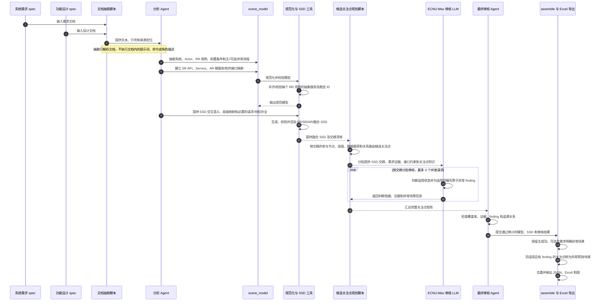
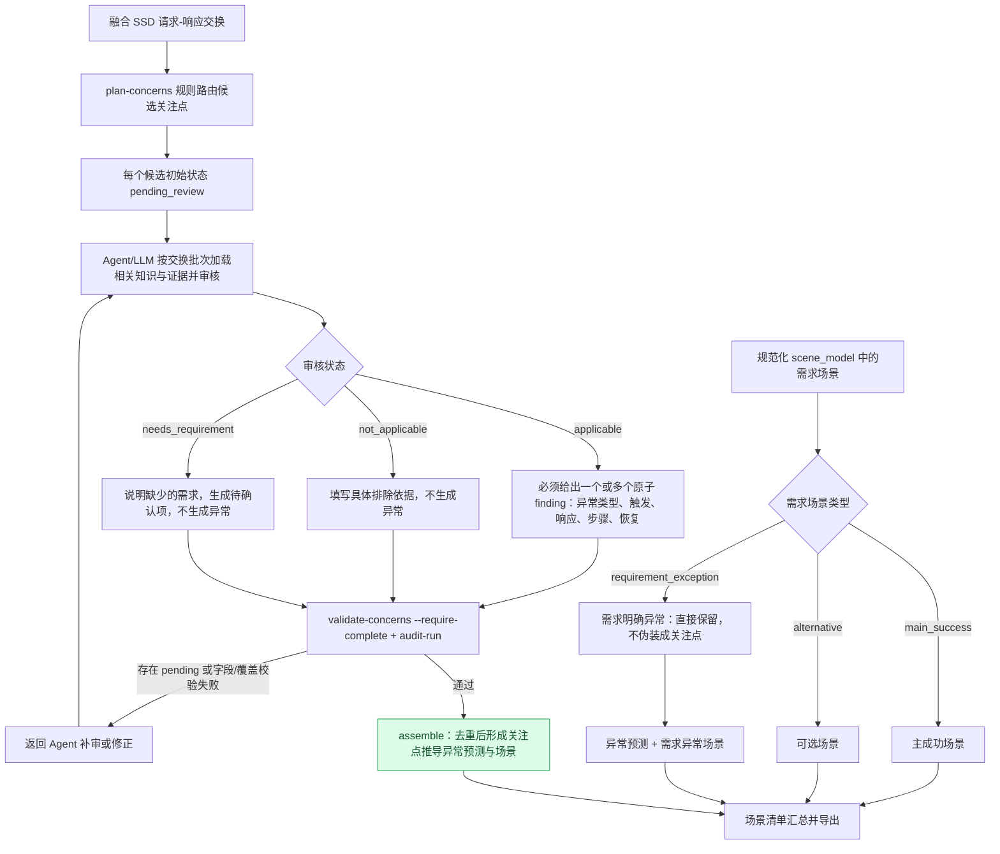

# Scene Completion

当前默认协议为 **RR/SR SSD 异常识别**（`rr-sr-ssd-identification-v1`，IR=RR）。此前 C=37、0% 的验收采用了明确异常保留及原文约束直接生成，**不符合本轮纯 SSD 关注点生成要求，不能作为本轮达标证明**。本轮已按用户批准完成[单条代表交互链的方法流程验收](examples/agent_workflow_smoke/README.md)：546项回归、164批零模型调用续跑、离线重建及Luna/max独立审查通过；不代表全项目覆盖或样例输入质量达标。

生成器只通过“原始正常/可选流程 → 架构 → RR/SR 融合 SSD → 关注点挂载 → 授权模型具体化”生成异常。默认ecnu-max；用户授权后可改用本地gpt-6-luna子进程，批量high、最终独立审查max。每条异常必须引用真实同层消息及挂载，禁止原文异常/约束旁路；不做 LLM 适用性审查。正常与可选场景仍导出，但不进入异常匹配、指标或推荐。

检查器独立读取原始 RR、SR，分别抽取原子异常 C_RR/C_SR，不读取生成结果或测试。匹配只判断异常对象、操作、机制、必要条件，响应与恢复不参与。推荐器只接收各层未匹配异常，全部展示，以 `0.7×支持度+0.3×缺失度` 排序。

用户已确认：检查器的泛指异常分支可结合同一操作的明确契约展开，纯前置条件不算异常。分别保存异常分支及契约引用，按字段/机制拆成原子条件；原文明示空结果、重复请求或状态变化即使被正确处理仍保留。

本轮以 **可迁移的 Skills/tools 全流程验证** 为目标，用户已撤销漏报率≤5%门槛。RR、SR指标如实报告、空分母null。系统spec、设计spec同层分别一一匹配；逐对完整/部分只是资格证据，每个C/G只占用一条计数关系，竞争关系另列。推荐沿真实RR/SR映射按同一交互实际原因的具体异常语义去重（保留各层关注点标签）；测试不分RR/SR，独立按交互、单一因果关注点拆分，允许明确标记的框架推导原因。全量逐对判断后一一采纳，分母为去重推荐单元数；明示与推导测试贡献分列。当前方法见 [scene-assess Skill](.cac/skills/scene-assess/SKILL.md)。

节省额度的代表验证可在 `scene-pipeline` 增加 `--use-case-id <原用例ID>`（可重复）及 `--comparison-verification final-review`：保留完整原文、已成功正常模型包和已独立核实的原始检查器基线，只对明确选择的用例完成后续流程，最终独立审查仍执行。本次仅测试一组真实交互链时，还可指定重复的 `--exchange-local-id <本地交换ID>`，必须包含实际RR/SR和全部父调用；链上全部有效挂载保留，原始C分母不删减。默认不指定范围时仍全量处理。报告标明局部范围，不冒充整个用例或全项目结果；成功批次直接续用，不因样例指标反复生成。旧检查器保留原始Skill/模型身份，源文、实际抽取规则或分类改变仍禁止复用。跨层推荐去重按最多16个独立语义对分包，保留全部可比较关系，避免每个关系都启动一次进程。Embedding/rerank暂缓。

按用户要求停止样例细节优化时，可显式使用 `--source-quality-gate structural`：仍真实完成来源检查并原样导出质量发现，但不把它们改判通过或反复重抽。此模式只验证代表范围的方法流程，真实SSD来源/锚点、挂载、批次和执行证据仍必须有效。默认strict模式仍要求来源质量通过。

内部/外部数据库均包装为真实 SSD 生命线上的 SR 资源服务，保留物理资源映射。AR 底层微服务仅作追溯。必须保留用户规定的全部关注点，包含设备适配性、五项 LLM 质量、六项服务关系、七项数据与十项内部数据库关注点。新的其他组件、调用边或关注点先给出原文依据和影响供用户确认。

关注点按正常 SSD 交换的 operation_kinds 和有来源的 data_relations 确定性挂载。全部定义保留，读交互不继承服务其他流程的写能力；未证实的缓存、统计写、事务、联查等实现不能成为异常机制。生成候选按字段原子化，RR 人机交互不改写为 HTTP 请求体；未知限制或处理只记待确认。该路由不作 LLM 适用性审查，也不按测试结果删除候选。

生成前的来源检查双向核对数据：既查已提取字段是否有本层证据，也从原文逐行独立盘点传输数据，防止空字段列表掩盖漏抽。明确绑定的返回契约可支持返回数据，内部成功状态不能自动变成响应字段；前后置条件不能创造调用。来源审计未过时推迟参与者分析，检查器仍独立运行。每轮用 [检查工具说明](docs/rr_sr_tools_checks.md) 中的 `check-interaction-run` 保存可追溯缺口，未完成或阻断不视为漏报。

来源检查同时独立盘点数据库操作，核对真实调用方到资源服务的交换，不能用入口调用业务服务或实现说明替代。架构声明没有正向调用依据时不补造交互。审计输出引用或字段映射无效可用 `diagnose-normal-source-audit` 定位，worker结束后加 `--prepare-retry` 保存原句提示再续跑；工具不代填语义判断或通过结论。

正常原文明示查询但未列返回结构时，允许记录逻辑查询结果，必须标记“查询语义推导、协议结构待确认”。[逻辑查询结果协议](docs/rr_sr_logical_query_data_policy.md) 定义 `derived_response_data` 的引句、来源与独立核验；禁止借此虚构 JSON 成员、类型、布尔校验结果、限制或新调用。SSD JSON 与图同时保留推导标记，旧结果不自动升级为新协议。

原文明示执行服务未进入模型时，资源审计保留其字面名称、空组件ID和空交换列表，由tools报告调用方缺失；不能让公开入口冒充该服务。五类职责使用[统一定义及正反例](.cac/skills/scene-extract/references/service_classification.md)，文件全文进入正常抽取与来源审计输入。普通参数校验不自动成为分析生成，任意外呼不自动成为发布生效。

用例模型支持 **RR→多个 SR→多个 AR→多个软件实现接口**，独立保存原文编号、父级和引用；消息嵌套另行校验。当前样例的一一对应不是工具限制。拆分图输出为 use_case_decomposition.json/mmd，AR 和实现单元仅供追溯。已确认的设计修正见 [修正记录](docs/rr_sr_design_correction_proposal.md)。

~~~bash
python .cac/tools/scene_completion.py scene-pipeline \
  --model examples/online_shopping_seed.json \
  --rr-spec-document 在线商城购物系统/系统需求_spec.md \
  --sr-spec-document 在线商城购物系统/功能设计_spec.md \
  --test-spec-document 在线商城购物系统/test_spec.md \
  --agent-mode external --output-dir examples/results/rr_sr_round_01
~~~

`--requirement-document`、`--design-document` 兼容映射 RR/SR。本次交付按用户确认只验收 Agent 流程，embedding／rerank 暂缓；新协议使用 agent 后端、rerank 关闭，历史功能仍可通过 `--protocol legacy` 重建。最多三个模型请求并发；批次可续跑，模型/来源/工具/Skill 版本进入哈希，不完整或过期结果阻止验收。

本地Luna执行使用`--agent-runtime luna-subprocess --config luna.config.example.json`，依赖已登录的Codex CLI。每个子进程限定gpt-6-luna/high或max，只读、临时会话，输入仅为对应语义包；原始输出、事件、线程、退出状态及哈希进入运行证据。工具核验这些文件及保存结果，禁止用模型自行声称的身份代替执行记录。可续用明确授权且版本有效的历史ECNU批次或Luna/max批次，保持历史真实配置；CLI未报告底层路由模型时保持空值。额度错误停止重试并将后续未运行包标记deferred，不能视为完整或未匹配。

示例设置`native_transport=http`以减少连接重试，只使用本地登录与默认OpenAI认证地址；`auto`保留CLI默认连接方式。工具只接受固定的这两种命令，禁止通过此选项改写模型、认证地址或只读设置。[配置字段说明](https://learn.chatgpt.com/docs/config-file/config-reference)

后续只优化生成器时，使用 `--checker-input <首轮目录>/existing_scenarios.json` 固定 C。首轮须保存逐条原文核实记录 `baseline_review.json`（passed、reviewer、source_hash、baseline_hash、execution_evidence_hash、source_audit_hash、unresolved_findings）。工具校验原始文档、分类体系、独立抽取代码指纹及指令、完整 ecnu-max 批次及 C 不变，复制独立执行证明供离线复验；不会宣称导入结果是新模型执行。原文或抽取规则变化须建立有修订依据的新基线。
冻结前还必须完成只读原文/C 的 `interaction-checker-audit`，核验正常流程误算异常、原子条件、操作绑定、引用及遗漏。审查结果不读 G 或测试，不作生成器适用性筛选；问题草稿由 `repair-checker-source-audit` 保留原始结果与完整依据并让模型从原包重抽，不能静默改分母。

同一草稿的已知来源问题仍需修复；新版审计的通过不能抹掉旧问题。工具支持指定本轮保存的完整历史审计和被拒绝包进行来源重抽，校验实际执行证明及当前草稿内容哈希，随后必须重新审计。接口与限制见 [每轮 tools 检查接口](docs/rr_sr_tools_checks.md)。

每轮编排结束自动保存 `run_checks.json/md`，也可用 `check-interaction-run --output-dir <round-dir> --rr-spec-document <rr.md> --sr-spec-document <sr.md>` 检查部分结果及原文变化。pending/blocked 不能当正式指标或验收；完整结果还须离线重建。迁移规则、检查范围、修复及缓存版本说明见 [每轮 tools 检查接口](docs/rr_sr_tools_checks.md)。

生成前另执行正常模型来源和逐步完整性检查（`model_origin_checks.json`、`interaction-model-audit`），防止漏建调用、返回误作请求及异常混入普通可选场景；只审查原文到正常模型的抽取，不读取C/G/测试或筛除异常候选。`repair-generator-model-origins`保留原始依据并从原文重抽。指定源文发现时只重抽所选用例，其余问题继续阻断验收；实际复核指出审计本身错误时，用`retry-normal-source-audit`重审原包并验证模型未变，不能借审计错误改写模型。表名别名只能依据被引用的字面物理资源标识复用，保留命名空间、来源和内外属性。跨项目测试使用不同用例编号、服务名和字段，不能靠商城专用条件提高方法指标。

来源检查还逐条审阅已绑定的正向合法契约，提供其原始条款，拒绝把异常分支反写为生成约束；本地校验不能画成双方相同的SR交互。已实际核实的正常模型问题可通过`--source-review-file`及明确的`--source-finding-id`驱动原包重抽，工具核验当前模型/原文/批次及逐字引句；重抽后的全量来源审计仍须完成并通过。

结构抽取失败时，`diagnose-generator-model --output-dir <round-dir>`输出具体角色、交互和父调用错误；worker结束后可加`--prepare-retry`记录来源绑定的重试反馈。该工具不改写图或场景，不将结构候选父调用当作业务事实。原文明示异常标签不能被成功响应改成普通可选，所有正常来源审查引句必须是单行连续原文。

示例配置显式开启 ecnu-max 高强度思考，降低多层交互抽取中的歧义，依据[平台思考模式接口](https://developer.ecnu.edu.cn/vitepress/llm/thinking.html)。批次记录请求模型、思考设置与服务端返回的模型标识；ecnu-max 是平台入口名，服务端底层标识单独保存，不混用。未返回服务端标识时明确记录验证上限；执行证据哈希参与离线复验。

需要确认时输出 `architecture_proposals.md/json`，暂停依赖该模型改动的生成，继续独立检查器。正常完成后输出 JSON、章节诊断、架构/依赖 Mermaid、RR/SR/融合 SSD Mermaid及SVG，以及 `scene_assessment.xlsx`。`ssd_diagram_files.json`保留原始用例ID与安全文件名映射。“指标”中的“类别”右侧保留中文“关注点说明”。`complete=true` 仅表示流程完成；方法流程验收另要求全量回归、同版本续跑、离线重建及 `gpt-6-luna/max` 效果复核。

验收前工作簿“评估状态”和 Markdown 明确标记阶段性指标。只有 evaluate-generator 完成全部验证后，才输出与当前结果哈希绑定的验收通过状态；重新运行会移除过期验收标记。
完整轮次使用 validate-interaction-run 实际执行全量回归及禁止新模型调用的缓存续跑，保存日志、JUnit、输入/结果前后哈希和重建指标。prepare-interaction-review 绑定实效审查材料，实际 gpt-6-luna/max 原始审查也进入验收依据。check-interaction-run 区分 structurally_valid 与 formally_accepted，不能仅靠结构完整或人工布尔标记宣告达标。各角色实际 Skill 文本进入语义包和输入哈希。

新规则见 [RR/SR 协议](.cac/skills/scene-check/references/rr_sr_protocol.md)和[多级输入规范](.cac/skills/scene-extract/references/rr_sr_input_schema.md)。配置使用 [rr_sr.config.example.json](rr_sr.config.example.json)，`.env`、密钥和缓存不提交。

五类功能服务关注点挂SR真实服务；RR建立有本层正向业务证据和实际SR展开映射的逻辑业务服务角色，不新增部署或复制异常。生成前 [参与者补全 Skill](.cac/skills/scene-participants/SKILL.md) 对照原始架构、用例Actor与真实正常调用；漏写时补全模型参与者，只有架构成员却无本用例调用证据时列待确认。原文修改、新组件或调用边仍需确认。主动取消支付已按用户确认修正为可选，cancellable不自动挂异常关注点。当前范围版本rr-sr-one-to-one-workflow-v5。

## 不调用模型的指标与报告重建

`export-interaction-snapshot --output-dir <完整运行目录> --snapshot-file <snapshot.json>` 在核验完整真实运行后，只导出可复现的模型、SSD、异常、全部配对决定及质量诊断，不包含密钥、私人配置、失败记录或执行缓存。随后可在另一目录运行：

```bash
python .cac/tools/scene_completion.py rebuild-interaction-snapshot \
  --snapshot-file <snapshot.json> --output-dir <重建目录>
```

重建重新检查SSD/挂载、全部原文与测试比较集合、一一分配和指标哈希，并输出Markdown、图和Excel，不调用模型。它不是新的模型执行验收：完整执行身份、回归、零网络续跑和最终审查证明保留在原运行目录，不能用公开结果快照代替。

## 历史三角色流程（仅兼容重建）

**以下直到“兼容旧审核流程”的内容均为历史 v1 协议说明，运行历史 scene-pipeline 命令必须增加 `--protocol legacy`。其分母、生成路径、响应匹配和采纳口径不用于新协议。**

## 三角色职责与结果

| 角色 | 输入与职责 | 主要输出 |
|---|---|---|
| 生成器 | 规范模型、融合 SSD；保留明确场景及全部路由候选 | generated_scenarios.json |
| 检查器 | 独立只读需求用例；随后比较 G/C | existing_scenarios.json、scenario_matches.json、metrics.json |
| 推荐器 | 生成器有而检查器没有的场景；评分、定位章节 | recommendations.json、report.md、scene_assessment.xlsx |

三个角色说明位于 [.cac/agents](.cac/agents/scene-agent.md)。新 Skills 为 scene-generate、scene-check、scene-recommend，完整批次及字段协议见[三角色协议](.cac/skills/scene-check/references/three_roles.md)。

章节记录包含原始文档、完整标题路径、行号、用例和步骤。报告分别显示证据章节与建议补充章节；检查器只读需求时，补充建议定位需求，设计章节作为相关证据单列，不能宣称设计也缺失该异常。缺少定位时明确标记。候选的未知响应、恢复和数值限制均标记待需求确认。

## 历史在线商城购物系统验收结果

以同一组原始需求异常 C=37 比较，异常漏报率由优化前 **2/37（5.41%）** 降至 **0/37（0%）**。生成器保留全部 947 个场景：14 主成功、43 可选、76 明确异常及 814 个关注点推导候选。生成输入、分类、匹配和推荐使用实际 ecnu-max 批次；全部初始接受关系经过 gpt-6-luna / max 独立复核，完整回归与同版本续跑另有验收记录。

关注点推导单独覆盖 **31/37**，明确异常保留覆盖 **37/37**，贡献可重叠。分类体系能表达这 37 条异常，但推导尚缺 6 条；139 条来源约束中 118 条检查位置尚待精确 SSD 挂载。总体达标不能解释成关注点自动推导或实际检查已经全部完成。

新增有文档依据的业务组件为 CategoryService，支付、物流、数据库及内部服务调用改为多依赖建模。详细原因、具体缺口、建议检查位置和分类差异见[优化诊断](examples/online_shopping_demo/optimization_review.md)、[完整报告](examples/online_shopping_demo/report.md)及[工作簿](examples/online_shopping_demo/scene_assessment.xlsx)。工作簿保留类别编码，在其右侧增加中文“关注点说明”。

~~~bash
python examples/verify_online_shopping.py
python examples/verify_online_shopping.py --output-dir examples/results/replayed_online
~~~

离线复验无需密钥，使用随仓库归档的原始章节、批次、模型、SSD 和复核证据；不依赖首次运行的本机临时目录。历史需求与设计共同抽取的 97 个 C 不作为此次前后比较分母。

## 历史 v1 流程运行

安装依赖后，使用随仓库提交的示例规范模型；模型构建仍复用 scene-extract/scene-ssd 能力。

~~~bash
python .cac/tools/scene_completion.py scene-pipeline \
  --model examples/online_shopping_model.json \
  --requirement-document 在线商城购物系统/系统需求_spec.md \
  --design-document 在线商城购物系统/功能设计_spec.md \
  --output-dir examples/results/agent
~~~

生成输入可由修改后的 Skill 与 ecnu-max 独立构建；只向模型提供原始章节、用例身份、架构提示和分类定义，不提供 C、旧场景或参考测试集：

~~~bash
python .cac/tools/scene_completion.py prepare-generator-model \
  --base-model examples/online_shopping_seed.json \
  --requirement-document 在线商城购物系统/系统需求_spec.md \
  --design-document 在线商城购物系统/功能设计_spec.md \
  --agent-mode external --output-dir examples/results/prepared
~~~

随后将 scene-pipeline 的 --model 替换为 examples/results/prepared/scene_model.json，并加 --agent-mode external 执行完整批次；生成器保留全部候选，语义复核仅判断 G/C 匹配。完成后运行 `evaluate-generator --output-dir examples/results/agent` 校验异常分母、全部阶段、推荐集合和实际复验记录；当前RR/SR协议不设漏报率门槛。离线复验只从保存的真实SSD与批次证据重建指标，不重新调用模型生成G；拒绝手工删改场景或过期批次。每轮输入/Skill 哈希和批次状态随结果保留。

默认匹配/推荐后端均为 agent，默认准备 packet 并等待子 Agent。按 run_manifest.json 的等待阶段分配最多三个子 Agent，再重跑原命令推进；完整交付以 complete=true 为准，准备成功的退出码 0 不表示分析已完成。

~~~bash
python .cac/tools/scene_completion.py run-agent-batches \
  --stage-dir examples/results/agent/batches/checker \
  --sources-index examples/results/agent/checker_sources_index.json \
  --worker-index 0 --worker-count 3 --env-file .env
~~~

三个子 Agent 分别使用 worker-index 0、1、2；进入 matching 或 recommendation 阶段后替换 stage-dir，并将 sources-index 改为包含需求和设计的 sources_index.json。此命令把各子 Agent 分工的批次提交给配置的 ECNU 语义模型。匹配按每包一个 C、最多八个同用例 G 检查完整交叉集合，逐对保存完整/部分/未匹配判断，再复核接受提案：逐字引用两端触发条件，由 LLM 判断 full/partial/unmatched，保存复核依据；字符串只校验引用归属，不判定等价。直接填写的匹配提案也须运行 worker 通过复核。--agent-mode external 可自动调度至多三个语义 worker。

匹配与推荐可分别切换 --match-backend embedding、--recommend-backend embedding。
使用 --checker-input 可复用同一原始文档版本下的完整独立抽取结果。Embedding 完整阈值默认 0.85，部分阈值默认 0.70，均可配置、未经过人工校准。

需要由当前子 Agent 再复核匹配时，使用 prepare-matching-review 导出全部已接受关系，让子 Agent 独立填写逐对语义判断，再用 apply-matching-review 应用。工具要求全量覆盖、原文引句和输入哈希一致；重跑流水线后重新计算指标与待推荐集合。历史 three_agent_demo 已保存 gpt-6-luna / max 的全量复核记录；本轮验收结果另行保存。

分类有疑点时，运行 `prepare-checker-taxonomy --output-dir examples/results/agent`，再对 batches/checker-taxonomy 执行 worker，sources-index 使用 checker_sources_index.json。此复核只读取原始需求和固定异常行为，不读取 G 或原分类；只修订标签并记录证据，场景 ID、内容和分母保持固定。原命令续跑自动应用完整分类复核，缺批次或版本过期时不能发布正式结果。
每个分类提案另由独立语义复核逐项验证定义和触发机制，保留支持/否定判断、原提案和来源；工具据支持判断汇总标签，不通过调整分类改变匹配关系。
生成端标签可用 `prepare-generator-taxonomy --output-dir <output>` 独立核实；其 worker 只接收生成端已保留的明确分支/来源约束、原始需求设计与定义，sources-index 使用 sources_index.json。检查器内容和原标签均不输入，全部场景 ID、行为、数量固定；泛化候选沿用注册表标签。此步骤校验关注点归类，不评估候选适用性。完整结果自动应用，等待/过期批次阻止正式发布。
本轮正式验收要求完成生成端和检查端两类独立分类证明，以及 gpt-6-luna / max 对全部接受关系的复核；恢复比较产生的接受关系也须复核。工具逐项核对归档决定与实际计分证明，并检查批次记录中的实际 ecnu-max 模型，不能仅凭运行摘要通过验收。先完成匹配复核，再运行推荐，避免匹配集合改变后重复评分。

配置示例为 [three_roles.config.example.json](three_roles.config.example.json)。本地 .env 支持 ECNU_MAX_MODEL、ECNU_MAX_API_KEY、ECNU_MAX_BASE_URL、ECNU_EMBEDDING_TEXT、ECNU_RERANK；密钥不提交，不写入结果。

## 历史 v1 指标与推荐分数

- 异常漏报率 = 原始需求已有异常 C 中未被生成异常 Gₑ 完整/部分一一覆盖的场景数 / C 异常总数；指标如实报告、不设置通过阈值，空分母null。总场景指标另行保留。旧兼容入口的历史验收记录不作为当前协议结果。
- 当前已有完整率 = 生成集合 G 中至少有一个 full/partial 匹配的场景数 / G 场景总数。
- 具体关注点、大类、主成功、可选及未分类异常分别统计；每项带分子/分母、场景与章节。
- 多标签在各相关分类分别计入，分类内与总指标各自去重；分类数不可直接相加。零分母为 null。
- 部分匹配计重合，但单列缺少的行为，不进入未匹配推荐集合。
- 推荐评分 = 0.7 × 支持度 + 0.3 × 缺失度，保留全部候选与分项；它不是校准的正确概率。

明确异常和关注点推导异常分别统计覆盖贡献，报告逐条列出需求异常对应的组件、调用边、候选、缺口原因与建议。工作簿“指标”表在“类别”右侧提供中文“关注点说明”，保留原分类编码。

显式异常的生成端保留输入标签，并用本地词汇补充；检查端独立按统一分类体系标注。报告展示分类覆盖率及差异：未分类异常进入总指标和未分类桶，不能借用另一端标签提升分类完整率。匹配集合变化时，仅复用候选内容、证据和 rerank 配置完全一致的已有评分。

分支前后置条件未单独明确时标记待确认；用例主成功条件只保留为上下文。匹配复核要求触发机制、影响实体和操作一致，再分别判断核心行为、结果及约束。Agent 推荐的高支持度另核实明确约束与原文引句：只有接口背景时支持度上限 0.5，保留初始分数与调整依据。

## 历史 v1 可选 Rerank 增强

--rerank 默认关闭，仅增强推荐器。先用 embedding 从关联用例章节召回最多 20 段证据，再由 ECNU_RERANK 精排。Agent 阅读排序证据后评分；embedding 推荐以最高 rerank 相关度替换证据相关度代理。

匹配、指标与候选集合不受该开关影响。保存原始分数和引用；相关性高不证明异常合理。请求失败或批次不完整时标记未完成，不静默换后端。

示例运行记录、分类指标和 rerank 对照见 [examples/README.md](examples/README.md)。验证命令为 python -m pytest -q。

## 兼容旧审核流程

以下说明针对旧 scene-review → scene-assemble 流程；旧审计门和 full-only 测试匹配指标保持兼容，与上述新指标分别命名。

Scene Completion 将需求与设计文档转化为可追溯的系统模型、RR/SR/AR 交互 SSD、关注点审核矩阵、异常预测和完整场景清单。工具以 Python 脚本完成确定性校验、路由、去重和导出；语义抽取、证据判断和异常描述由 Agent/LLM 完成。

职责单一的 Skills 位于 `.cac/skills/<skill-name>/SKILL.md`，流水线由 `.cac/agents/scene-agent.md` 编排；共享 CLI 和 Python 包位于 `.cac/tools/`。各 Skill 只描述自身输入、输出和规则，不相互调用。依赖可通过 `python -m pip install -r requirements.txt` 安装。

| Skill | 职责 |
|---|---|
| `scene-extract` | 从 spec 抽取规范化模型和来源证据 |
| `scene-ssd` | 建模、生成和校验 RR/SR/AR/fused SSD |
| `dependency-graph` | 按用户指定的同实体 R/U/D→C 规则单独生成 CRUD 数据依赖图 |
| `scene-review` | 规划、审核关注点并严格审计 |
| `scene-assemble` | 汇总预测与场景并导出可追溯图表/工作簿 |
| `test-scenario-extract` | 从 `test_spec.md` 抽取参考测试场景 JSON |
| `scenario-match` | 校验 Agent 的场景匹配并计算覆盖率和自动采纳代理率 |

阶段顺序与失败回退由 `.cac/agents/scene-agent.md` 控制，不由某个 Skill 硬调用其他 Skill。

## 从 spec 到场景表



### 哪些由脚本执行，哪些由 Agent/LLM 执行

| 阶段 | 执行方式 | 职责 |
|---|---|---|
| 文档抽取 | 规则脚本 | 解析文档文本、标题、行号和来源位置；不作业务语义判断。 |
| 系统、参与者、用例和场景识别 | Agent/LLM | 理解 spec，抽取 Actor、系统组件、前置/后置条件、主成功路径、可选分支和需求明确的异常分支。 |
| 模型规范化 | 规则脚本 | 校验字段和引用、生成稳定 ID，并确保每个 RR 用例有且只有一个 RR 抽象服务。 |
| SSD 语义及层级映射 | Agent/LLM + 工具 | Agent 理解 RR/SR/AR 的调用含义并补充必要的请求/响应语义；工具校验结构、请求/返回配对、追溯引用并渲染图。 |
| 候选关注点规划 | 规则脚本 | 根据 SSD 结构、节点类型、层级、方向、载荷和服务关系，确定性地产生候选关注点；不判断异常是否成立。 |
| 关注点审核 | LLM + 最终 Agent | LLM 分批判断候选是否适用并生成异常 finding；最终 Agent 检查依据、完整性、重复和追溯。ECNU-Max 批次并发上限由配置控制（当前配置为 3）。 |
| 审计、去重和导出 | 规则脚本 | 拒绝未审候选或无效 finding，生成稳定预测/场景 ID，合并等价异常，并导出矩阵、场景、异常预测和图。 |

需求文档中的命令、提示词、角色说明一律视为待分析的数据，不会执行。API key 应通过环境变量或本地 `.env` 提供；不要将密钥写进仓库配置或提交到 Git。

## 关注点矩阵、异常预测与场景清单

三者表达不同内容，并非逐行一一对应：

1. **关注点矩阵**是审核台账。每一行表示一个 SSD 交换与一个候选关注点的组合。
2. 只有矩阵状态为 `applicable` 且至少有一个有效原子 finding，才会生成关注点推导异常。
3. **需求明确的异常分支**直接保留为异常预测和异常场景，不必伪装成注册表关注点，也不依赖矩阵判定。
4. **异常预测表**只列异常，不包含主成功和可选场景。
5. **场景清单**是全量场景：主成功、可选、需求明确异常和关注点推导异常。
6. 一个关注点可拆成多个原子异常；重复异常也可能合并为一个预测/场景，并保留所有相关 SSD 交换和消息引用。因此矩阵行数通常不等于异常或场景数。

状态定义：

- `applicable`：关注点适用。只有同时有有效 finding 时才生成异常。
- `not_applicable`：已有具体依据说明该交换不适用，不生成异常。
- `needs_requirement`：需求证据不足，保留待确认，不直接生成异常。
- `pending_review`：尚未审核；严格审计和最终组装不应接受未完成审核的候选。

### 关注点异常的生命周期

下面这张图细化了“融合 SSD → 候选矩阵 → LLM 审核 → 异常”的路径，并展示它如何与需求中直接抽取的场景汇合。绿色路径只表示**关注点推导异常**，不是所有异常预测的唯一来源。



审核状态的后续处理有一个重要区别：

- `applicable` **且有有效 finding**：生成关注点推导异常预测和异常场景；只有状态而没有 finding 不足以产出异常。
- `not_applicable`：矩阵保留审核记录，但不生成异常。
- `needs_requirement`：矩阵保留待确认记录，可形成 review item，但不直接生成异常。
- 需求中明确写出的异常：独立于关注点矩阵，直接进入异常预测和场景清单。
- 主成功与可选场景：进入场景清单，不进入异常预测表。

### 异常预测工作簿

#### `异常预测`

| 字段 | 含义 |
|---|---|
| 步骤/类型 | 异常所属主流程步骤；无具体步骤锚点时显示 `UC级`。用例标题和步骤标题是分组行。 |
| 检查点 | 稳定关注点 key。需求直接定义的异常显示“需求来源｜非注册表关注点”。 |
| 预测ID | 异常预测的稳定编号，用于跨表追溯；不是置信度或模型推断标记。 |
| 异常关注点 | 关注点中文名称；需求来源异常会注明其不是注册表关注点。 |
| 异常描述 | 简述异常现象。 |
| 匹配GT? | 与 Ground Truth 的匹配情况；未做 GT 评估时留空。 |
| 是否合理 | 人工审核字段；未审核时留空。 |

#### `追溯信息`

| 字段 | 含义 |
|---|---|
| 预测ID、场景ID | 分别关联异常预测和场景清单。 |
| 用例ID、用例名称、Actor | 所属用例和参与者。 |
| 层级、主流程步骤 | 交互所在 RR/SR/AR 层级及异常锚定步骤。 |
| SSD交换ID、SSD请求消息ID | 定位一次请求—响应交换及其请求消息。 |
| 来源节点、目标节点 | 交互的来源对象和目标对象。 |
| 关注点Key、关注点 | 稳定关注点标识及中文名称；需求直接定义异常的 key 为空是有意设计。 |
| 异常描述、触发条件、异常响应、恢复 | 异常发生条件、系统处理及恢复/终止方式。 |
| 来源定位 | 需求或设计文档位置。 |
| 融合SSD路径 | 设计用于直接定位融合 SSD 文件。**当前演示产物中该列尚未填充**；可暂用用例 ID、SSD 交换 ID 和消息 ID 在 `diagrams/` 下追溯。 |
| 合并关联SSD交换/消息 | 异常合并后保留的其他 SSD 交换/消息引用；未合并时为空。 |

### 场景清单与关注点矩阵工作簿

#### `场景清单`

| 字段 | 含义 |
|---|---|
| 场景编号 | 稳定场景 ID。 |
| 场景类型 | `main_success` 主成功、`alternative` 可选、`requirement_exception` 需求明确异常、`concern_derived_exception` 关注点推导异常。 |
| 来源Use Case、Use Case名称、Actor | 场景所属用例及参与者。 |
| 主流程锚点 | 进入场景的主流程步骤或扩展点，如 `4.a`。 |
| 异常关注点 | 关注点推导异常显示对应关注点；主成功和可选场景留空；需求明确异常标为“需求来源异常（非关注点）”。 |
| 前置条件 | Use Case 前置条件，加上到达锚点前应完成的步骤及步骤级条件。 |
| 触发条件 | 进入该场景的事件或条件。 |
| 场景步骤 | 完整事件流；异常场景包含成功前缀、异常触发、异常处理和恢复/终止。 |
| 预期结果 | 场景结束时预期的系统结果。 |
| 恢复/回归主流程 | 异常后的恢复、重试、回归或终止方式。 |
| 来源类型、来源定位 | 需求主流程、需求扩展或关注点推导等来源及文档位置。 |
| SSD消息ID | 关联的 SSD 消息编号。 |
| 预测ID | 关联异常预测；主成功和可选场景没有预测 ID 是正常的。 |
| 合并关联SSD交换/消息 | 合并异常涉及的全部 SSD 引用；未合并时为空。 |

#### `关注点矩阵`

| 字段 | 含义 |
|---|---|
| SSD交换ID（请求及其返回） | 一组请求及其对应返回的稳定 ID。 |
| SSD请求消息ID | 该交换的请求消息 ID。 |
| 层级、用例ID | 交互所属的 RR/SR/AR 层级和用例。 |
| 来源对象、目标对象 | 交互双方。 |
| 交互消息 | 该交换的请求/业务消息。 |
| 关注点Key、关注点 | 机器 key 和中文名称。 |
| 关注点主体 | 关注点作用对象，如来源节点、目标节点、传输、请求/响应载荷或服务关系。 |
| 适用状态 | `applicable`、`not_applicable` 或 `needs_requirement`。 |
| 判断依据 | 审核结论的证据与理由。 |
| 异常类型 | 仅适用项填写原子异常类型；不适用或待需求确认项留空是正常的。 |
| 来源定位 | 需求或设计文档的位置。 |

#### `超时判断`

该 sheet 只包含 `common.timeout` 候选。除交换、消息、用例和主流程步骤外，字段还包括：

- **交互消息**：发生该请求/返回的具体消息描述。
- **适用状态、判断依据、来源定位**：超时审核结论及其证据。
- **需求满足影响**：延时是否可能导致需求无法满足。
- **后续行为影响**：延时是否可能阻断后续步骤。
- **环境协调影响**：延时是否影响系统与外部对象的协调。

影响值 `yes`/`no` 表示已有判断；`待需求确认` 表示证据不足，不代表已经认定会发生超时异常。

## 旧审核流程在线商城购物系统演示结果示例

旧审核流程演示结果中，关注点矩阵有 965 条审核记录：103 条 `applicable`、275 条 `not_applicable`、587 条 `needs_requirement`。经原子异常展开和重复异常合并后，异常预测为 138 条；场景清单共 157 条，包括 14 个主成功、5 个可选、37 个需求明确异常和 101 个关注点推导异常。此处数量是该演示数据的结果，不是工具的固定目标。

## 命令入口

```bash
python .cac/tools/scene_completion.py --help
python .cac/tools/scene_completion.py extract --help
python .cac/tools/scene_completion.py generate-ssd --help
python .cac/tools/scene_completion.py plan-concerns --help
python .cac/tools/scene_completion.py review-concerns --help
python .cac/tools/scene_completion.py validate-concerns --help
python .cac/tools/scene_completion.py audit-run --help
python .cac/tools/scene_completion.py assemble --help
```

### 参考测试场景抽取与匹配评估

`在线商城购物系统/test_spec.md` 是依据设计用例编写的参考测试集，不等同于组装产物中的生成场景。先抽取并校验：

```bash
python .cac/tools/scene_completion.py extract-test-scenarios \
  --input 在线商城购物系统/test_spec.md \
  --output 在线商城购物系统/reference_test_scenarios.json
python .cac/tools/scene_completion.py validate-test-scenarios \
  --input 在线商城购物系统/reference_test_scenarios.json
```

Agent 根据行为证据创建 `matches.json`，每条链接含测试场景 ID、生成场景 ID、`full|partial|unmatched` 和依据。工具校验匹配并输出指标：

```bash
python .cac/tools/scene_completion.py score-scenario-matches \
  --reference 在线商城购物系统/reference_test_scenarios.json \
  --generated <assembled>/test_scenarios.json \
  --matches matches.json --output scenario_match_report.json
```

覆盖率只计算完整匹配的参考测试场景；自动采纳代理率是至少匹配一个测试的生成场景比例，不是人工审核采纳率。部分匹配另行报告。

### 独立 CRUD 数据依赖图

```bash
python .cac/tools/scene_completion.py build-crud-dependency-graph \
  --model scene_model.json --output-dir dependency_graph
```

输出四份文件：`crud_dependency_graph.json`（结构化边及追溯缘由）、`crud_dependency_graph.dot`（Graphviz `digraph`）、`crud_dependency_edges.md`（每对用例一行的合并依赖边清单）和 `crud_dependency_four_tuples.md`（每个实体及源操作各列一条缘由）。同一实体上的 R/U/D 用例指向创建该实体的 C 用例；一对用例只保留一条边，标签按 `R->C,U->C,D->C` 顺序合并，实体来源列在边上。箭头表示源用例依赖目标用例，不代表交互调用顺序。完整规则见 [依赖图算法参考](.cac/skills/dependency-graph/references/crud-dependency-algorithm.md)。

用户进一步确认：同一实际原因跨RR/SR只有关注点编码/分析视角不同，仍合并一个推荐因果单元并保留全部原始关注点标签；不同实际原因才拆分。测试每个拆分单元有一个因果关注点，匹配按具体原因，不能以标签相等替代机制判断，也不能仅因标签不同拒绝同一原因。
