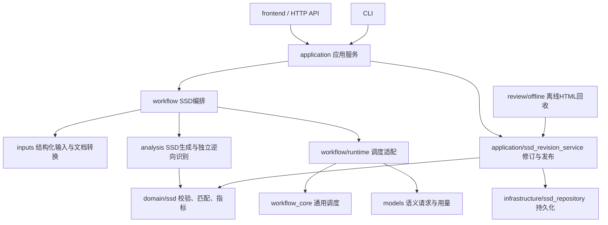

# 架构与代码导览

默认运行入口是SSD三方比较流程。`compat`保留仍在使用的详细流程、独立分析格式和保存报告能力，不代表恢复v2/v3/v4协议。版本含义见[版本与兼容边界](../reference/versions.md)，唯一文件迁移清单为[module-map.json](module-map.json)。

## 主链与依赖方向

`application/input_service`组织输入扫描、接纳与监控；`domain/task_extensions`保存任务Schema扩展注册，避免领域层反向依赖分析层；`infrastructure/identity`提供纯指纹计算。`analysis/scenarios/eligibility`协调输入解析和计分资格，纯场景类型规则仍留在`domain/scenario_types.py`。

HTTP与CLI处理参数及响应，应用服务组织用例操作；领域代码决定有效定位、匹配和指标，仓储负责文件、锁与不可变版本。页面与路由不重复实现计分；输入转换不承担报告展示，持久化不负责调用模型。

`serve.py → api/application.create_app → application/project_service.Workbench`装配本地服务。`scene.py → cli/main`使用相同公开能力。`application/execution.Execution`组织执行会话，`workflow/planning.build_pipeline`选择结构化输入或文档抽取路径。

结构化输入由`workflow/ssd_pipeline.build_structured`按用例进入三个阶段。原始RR/SR文档通过`build_from_documents`获得抽取产物，再由`inputs/documents/ssd_adapter.normalize_extracted_case`转为共同用例结构；这是当前文档输入适配，不是旧协议执行。

## 目录职责

| 目录 | 职责与边界 |
|---|---|
| `application/` | 项目、运行配置、执行控制和SSD修订用例；协调业务服务 |
| `domain/`、`domain/ssd/` | 协议、Schema、注册表及SSD校验、匹配、指标；不负责项目文件写入 |
| `workflow/` | SSD主编排、规划、发布；`runtime/`为调度适配，`recovery/`为有限恢复 |
| `workflow_core/` | 通用DAG依赖、并发、暂停、检查点；不放SSD业务规则 |
| `inputs/` | `structured/`结构化材料，`documents/`文档转换，`provenance/`来源索引，及导入采用 |
| `analysis/` | 按`ssd/`、`concerns/`、`scenarios/`、`matching/`、`evaluation/`、`interactions/`等职责计算 |
| `models/` | 模型路由、传输、流式、限流、上下文和用量；不改变业务结果版本 |
| `review/` | `offline/` SSD HTML，`handoff/`原业务包，`decisions/`人工决定，`truth/`审核真值 |
| `compat/` | 显式保留的详细流程、独立旧格式与保存报告，见下节 |
| `manager/` | 管理Agent、质量诊断与隔离补丁，仍遵守应用和领域边界 |
| `api/`、`cli/` | HTTP与命令装配；公开URL和参数不因目录迁移改变 |
| `infrastructure/` | 项目存储、事件、进程、资源定位及SSD仓储 |

## 三种兼容职责

| 目录 | 实际用途 | 与SSD主流程的关系 |
|---|---|---|
| `compat/detailed/` | 既有细粒度节点编排及历史mock契约 | 显式兼容执行路径，不作为新主流程的默认入口 |
| `compat/standalone/` | `scene-case-analysis-v1`的准备、校验、导入和既有工件处理 | 保留原G/E/GT和匹配；导入后可发布到共同SSD结果服务 |
| `compat/saved/` | 读取原先保存的报告、图表和指标 | 展示历史事实，不以目录整理为由重算报告 |

这些职责分别维护，不按v9/v10/v11复制源码。独立分析新命令`build`产生`ssd-case-v1`；`schema`、`prepare`、`finalize`保留原独立格式，见[独立分析与保存结果](../current/standalone-and-saved-results.md)。

## 前端

`frontend/src/app`装配项目、工作区及全局状态；`features`按功能拥有页面、API、类型和测试，`shared`只保留跨功能请求、类型与工具，`components/ui`保留基础组件。

`features/results/ResultsView.tsx`只负责结果入口。`ssd/`包含三方编辑、步骤、修订、来源弹窗、离线回导和局部API/types；`saved/`保留历史及独立导入结果、范围和指标；`shared/`保存被结果页、输入页、节点页或审核页共同使用的产物/对照组件。Markdown阅读器继续由`features/sources`共享。

结果页先读取`ssd-results`，存在共同结果时使用SSD页，否则保留原保存结果页。切换模块不修改请求URL、历史ID、localStorage键、Effect触发或未保存草稿保护。

## 代码、产物与运行数据

`frontend/src`是源码，`web/`是成套构建的网页，`dist/`是本地打包产物。`deployment/windows/`是发布模板，`deployment/experiments/`是历史本机实验脚本，不是通用启动入口。

`.workbench/`、`runs/`、原始文档、账户、额度账本、审核与报告记录不随代码迁移。保存的source ID、任务ID、输入/产物相对路径及公开HTTP/CLI契约保持不变。统一资源位置由`infrastructure/paths.py`解析；开发与发布见[开发约定](development.md)。
