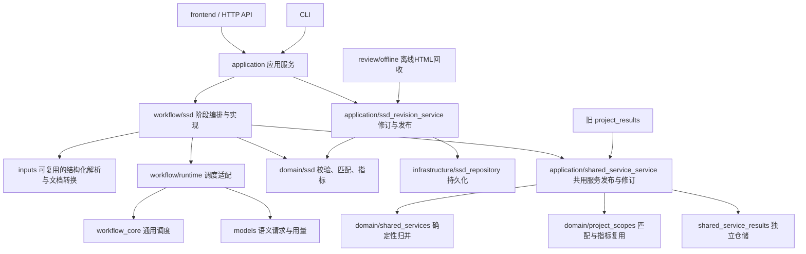

# 架构与代码导览

默认运行入口是交互三方比较流程，业务链路退出当前分析。外部服务在交互中生成后归并，历史链路与架构只读。`compat`保留仍在使用的详细流程、独立分析格式和保存报告能力，不代表恢复v2/v3/v4协议。版本含义见[版本与兼容边界](../reference/versions.md)，唯一文件迁移清单为[module-map.json](module-map.json)。

## 主链与依赖方向

`application/input_service`组织输入扫描、接纳与监控；`domain/task_extensions`保存任务Schema扩展注册，避免领域层反向依赖分析层；`infrastructure/identity`提供纯指纹计算。`analysis/scenarios/eligibility`协调输入解析和计分资格，纯场景类型规则仍留在`domain/scenario_types.py`。

HTTP与CLI处理参数及响应，应用服务组织用例操作；领域代码决定有效定位、匹配和指标，仓储负责文件、锁与不可变版本。页面与路由不重复实现计分；输入转换不承担报告展示，持久化不负责调用模型。

`serve.py → api/application.create_app → application/project_service.Workbench`装配本地服务。`scene.py → cli/main`使用相同公开能力。`application/execution.Execution`组织执行会话，`workflow/planning.build_pipeline`选择结构化输入或文档抽取路径。

`workflow/ssd/pipeline.py`选择用例、注册依赖并写入流程进度。它复用同一套 SSD 阶段处理结构化输入和 RR／SR 文档抽取结果。阶段定义与语义任务集中在 `workflow/ssd_stages.py`，[结构化输入工作流](../current/structured-input-workflow.md)由它生成。

## 按顺序阅读 SSD

下表目录均位于 [`src/scene_completion/workflow/ssd/`](../../src/scene_completion/workflow/ssd/)。五个调度阶段从各自的 `stage.py` 开始读。

| 目录 | 从这里读 | 主要产物 |
|---|---|---|
| `input_conversion/` | `core_input.py` 的 `inspect`、`convert`、`validate_core`，以及 `case_builder.py` 的 `build_cases` | 核心文件、待决映射、出处索引和运行用例 |
| `prepare/` | `stage.py` 的结构化与文档两种准备入口，`snapshot.py` 的冻结与验证 | 核心快照、初始三方容器和初始发布版本 |
| `resolve/` | `stage.py`，再读操作、实体和来源分类模块 | CRUD、约束挂载、独立 E／GT 分类和待确认项 |
| `generate/` | `fixed.py`、`command_fields.py`、`scenarios.py` 和 `stage.py` | 固定关注点、固定场景、G 业务分析及补充场景 |
| `compare/` | `alignment.py` 和 `stage.py` | E／GT 对齐到最终 G、判定复用、语义匹配及发布 |
| `shared_services/` | `stage.py` | 按用例触发外部服务归并及发布 |
| `shared/` | 按绑定、失败位置、语义执行和基线复用进入 | 各阶段共同使用的上下文与稳定身份 |

`workflow/ssd_pipeline.py` 和 `analysis/ssd/` 保留既有导入入口。共用服务的归并规则仍由 `domain/shared_services/` 维护，修订和发布由应用服务处理。领域层继续提供三方校验、匹配与指标。

### 来源文件到核心 JSON

| 来源 | `input_conversion/` 中的映射 | 主要输出 |
|---|---|---|
| `SysOperation.json` 的参与者、顺序、交互、动作和响应 | `sys_operation.py` 提取步骤和参与者，`case_builder.py` 统一用例与步骤身份 | `architecture.json`、`main-success.json` |
| `功能树.json` 的用例、命令与实体属性 | `function_tree.py` 对齐同用例的接口契约，`case_builder.py` 组装实体目录 | `main-success.json` 的命令、实体与约束 |
| 行为模型中的原文异常和分支文件 | `requirements.py` 读取分支，`evidence_records.py` 处理本方证据 | `existing-exceptions.json` |
| `recovered_usecases.json` 与测试证据 | `test_evidence.py` 按用例读取测试扩展，保留命中、待确认和来源 | `test-exceptions.json`、`extension-mapping.json` |
| 中间 JSON 引用及配置的 Markdown／XLSX 原件 | `provenance.py` 索引原件，`core_files.py` 写出各核心分件和引用 | `source-map.json`、原文清单及随包证据 |

## 目录职责

| 目录 | 职责与边界 |
|---|---|
| `application/` | 项目、运行配置、执行控制和SSD修订用例；协调业务服务 |
| `domain/`、`domain/ssd/` | 协议、Schema、注册表及SSD校验、匹配、指标；不负责项目文件写入 |
| `workflow/` | `ssd/` 为正式 SSD 各阶段的实现，`runtime/` 为调度适配，`recovery/` 为有限恢复 |
| `workflow_core/` | 通用DAG依赖、并发、暂停、检查点；不放SSD业务规则 |
| `inputs/` | `structured/`结构化材料，`documents/`文档转换，`provenance/`来源索引，及导入采用 |
| `analysis/` | 通用关注点、场景、匹配、评估和交互分析，`ssd/` 保留原导入入口 |
| `models/` | 模型路由、传输、流式、限流、上下文和用量；不改变业务结果版本 |
| `review/` | `offline/` SSD HTML，`handoff/`原业务包，`decisions/`人工决定，`truth/`审核真值 |
| `compat/` | 显式保留的详细流程、独立旧格式与保存报告，见下节 |
| `manager/` | 管理Agent、质量诊断与隔离补丁，仍遵守应用和领域边界 |
| `api/`、`cli/` | HTTP与命令装配；公开URL和参数不因目录迁移改变 |
| `infrastructure/` | 项目存储、事件、进程、资源定位、SSD仓储及项目范围仓储 |

`domain/concern_templates.py` 维护固定参考异常。`workflow/ssd/generate/scenarios.py` 负责 `ssd-generate` 的模型分析与补充校验。业务链路与项目架构结果继续通过历史投影查看。

## 三种兼容职责

| 目录 | 实际用途 | 与SSD主流程的关系 |
|---|---|---|
| `compat/detailed/` | 既有细粒度节点编排及历史mock契约 | 显式兼容执行路径，不作为新主流程的默认入口 |
| `compat/standalone/` | `scene-case-analysis-v1`的准备、校验、导入和既有工件处理 | 保留原G/E/GT和匹配；导入后可发布到共同SSD结果服务 |
| `compat/saved/` | 读取原先保存的报告、图表和指标 | 展示历史事实，不以目录整理为由重算报告 |

这些职责分别维护，不按v9/v10/v11复制源码。独立分析新命令`build`产生`ssd-case-v1`；`schema`、`prepare`、`finalize`保留原独立格式，见[独立分析与保存结果](../current/standalone-and-saved-results.md)。

## 前端

`frontend/src/app`装配项目、工作区及全局状态；`features`按功能拥有页面、API、类型和测试，`shared`只保留跨功能请求、类型与工具，`components/ui`保留基础组件。`features/results/project/`承载业务链路与项目架构的三方对照、依赖表、依赖图和分层指标。

`features/results/ResultsView.tsx`只负责结果入口。`ssd/`包含三方编辑、步骤、修订、来源弹窗、离线回导和局部API/types；`saved/`保留历史及独立导入结果、范围和指标；`shared/`保存被结果页、输入页、节点页或审核页共同使用的产物/对照组件。Markdown阅读器继续由`features/sources`共享。

结果页先读取`ssd-results`，存在共同结果时使用SSD页，否则保留原保存结果页。切换模块不修改请求URL、历史ID、localStorage键、Effect触发或未保存草稿保护。

## 代码、产物与运行数据

`frontend/src`是源码，`web/`是成套构建的网页，`dist/`是本地打包产物。`deployment/windows/`是发布模板，`deployment/experiments/`是历史本机实验脚本，不是通用启动入口。

`.workbench/`、`runs/`、原始文档、账户、额度账本、审核与报告记录不随代码迁移。保存的source ID、任务ID、输入/产物相对路径及公开HTTP/CLI契约保持不变。统一资源位置由`infrastructure/paths.py`解析；开发与发布见[开发约定](development.md)。
