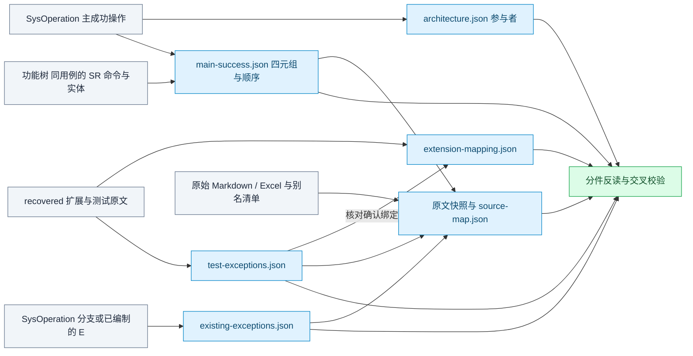
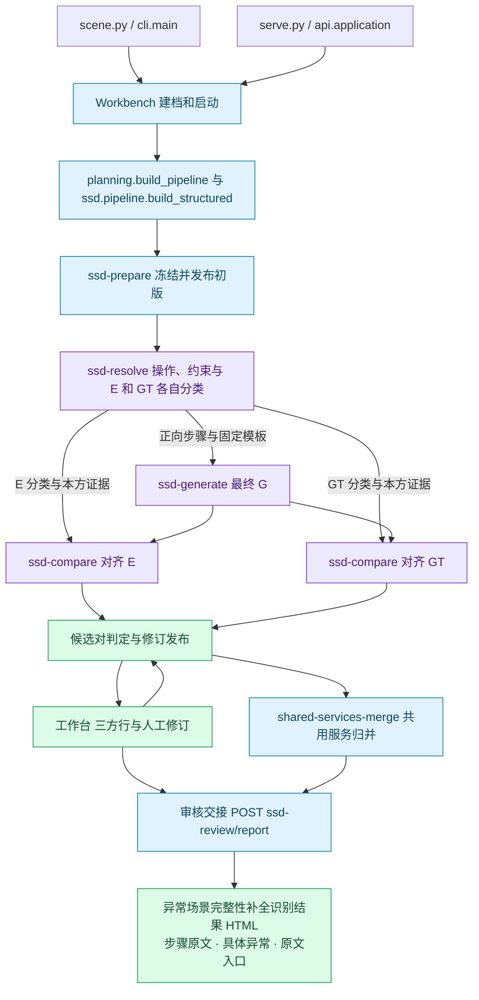

# 从同事的结构化材料到 SSD 离线报告

从四元组读一个用例：**谁发送、谁接收、做什么操作、传哪些数据**。先确定步骤身份，再看每个失败条件挂在哪一步、由哪方证据支持。下文沿用仓库合成用例「浏览商品」，可以在同一份结果上对照源文件、核心分件、工作台行和报告。[样例目录](../../datasets/mini-mall/examples/browse-product/)

| 手头的问题 | 第一处代码 | 接着看 |
|---|---|---|
| 同事改了 SysOperation，顺序、参与者或实体不对 | [sys_operation.py](../../src/scene_completion/workflow/ssd/input_conversion/sys_operation.py) 的 `_steps`、`_person` | `case_builder.build_cases` 选择输入，`core_files._main` 写出四元组 |
| 接口或字段没挂到预期步骤 | [function_tree.py](../../src/scene_completion/workflow/ssd/input_conversion/function_tree.py) 的 `for_case → catalogue` | `shared/command_bindings.attach` 先挂，`resolve/operations.resolve` 确定主调用 |
| E 或 GT 引文错了，或者把两个边界混在一起 | [classification.py](../../src/scene_completion/workflow/ssd/resolve/classification.py) 的 `classify` | 先查本方来源及逐 part 摘录，再进 [alignment.align](../../src/scene_completion/workflow/ssd/compare/alignment.py) 看候选 |
| 要改匹配、三方行或计分 | [matching.py](../../src/scene_completion/domain/ssd/matching.py) 的 `binding` 与候选对，随后 [g_grain.rows](../../src/scene_completion/domain/ssd/g_grain.py)、[metrics.analyze](../../src/scene_completion/domain/ssd/metrics.py) | 工作台 `comparison.scenarios[].cells`，报告归类用 `domain/business_report.classify` |
| 要改老师报告的列、筛选或保存 | [business_report_export.export_html](../../src/scene_completion/review/offline/business_report_export.py) | [离线 HTML 模板](../../src/scene_completion/review/offline/_teacher_report_template.py) 与 [浏览器行为回归](../../tests/support/offline_teacher_report.mjs) |

## 1. 发现来源，生成一版核心文件



**图例**　灰色为同事提供的材料，蓝色为脚本写入的分件和出处，绿色为建档前的校验入口。

建议一项目分为 `source/`（收到的材料）、`core/<revision>/`（每次转换的新目录）、`workbench/`（建档和运行）、`delivery/`（导出 HTML）。核心根存 `architecture.json`、使用的功能树、可用的 recovered 文件及配套原件。源目录提供 `source-documents.json` 时随核心复制。五个用例分件位于 `cases/<稳定目录>/`，运行命令用 `case.id` 选用例。分件引用的 `source-evidence/` 随版本保存。

1. [cli/main.main](../../src/scene_completion/cli/main.py) 给 `core-input inspect/convert` 选择默认 `command-interaction-v3`。在 [core_input.py](../../src/scene_completion/workflow/ssd/input_conversion/core_input.py) 按 `inspect → convert → validate_core` 读。`inspect` 返回输入文件集的 `input_hash`、用例和问题。`convert` 在暂存目录写核心并反读校验，成功后才把该目录改名为指定输出。
2. [case_builder.build_cases](../../src/scene_completion/workflow/ssd/input_conversion/case_builder.py) 汇集三条来源。用例名分别取 `SysOperation.use_case`、`functions[].name`、recovered 用例的 `name`。名称比较使用 Unicode NFKC、去首尾空白和大小写折叠，同名时用资源或实体目录缩小范围。已明确的核心来源编号可以指定来源。运行 ID、功能树编号和测试编号分别保留。[名称解析](../../src/scene_completion/inputs/structured/case_names.py)
3. `sys_operation._steps` 从主成功操作取参与者、事件、动作、交互、响应和顺序。`function_tree.catalogue` 收集同用例 SR 命令属性，`inputs/provenance/ssd_sources.entities_for` 读实体属性。[requirements.existing_channel](../../src/scene_completion/workflow/ssd/input_conversion/requirements.py) 与 [evidence_records.recognize_records](../../src/scene_completion/workflow/ssd/input_conversion/evidence_records.py) 收 E。[test_evidence.test_channel](../../src/scene_completion/workflow/ssd/input_conversion/test_evidence.py) 对每个测试扩展查同用例的证据。转换保留未决条件和失败提示，供后续独立识别。
4. [core_files.write_core](../../src/scene_completion/workflow/ssd/input_conversion/core_files.py) 写分件，[authoring_cases.read](../../src/scene_completion/inputs/structured/authoring_cases.py) 按用例目录和项目架构拼回，`sys_operation(document)` 适配到同一构建器。[core_validation._cross_check](../../src/scene_completion/workflow/ssd/input_conversion/core_validation.py) 核对参与者、步骤、CRUD、数据义务及测试绑定。`valid` 表示通过阻塞校验，需同时读 `issues[].kind` 中的 `pending` 和 `unassessed`。
5. 遇到新变体，Coding Agent 核对原文件、候选 ID 和引文。对允许的补充项，用本次 `input_hash` 与 `core-input-overrides-v1` 提交有证据的 patch，输出到下一版核心并重新 validate。可写字段以 `core_input.PATCHES` 为准，包括参与者类型、步骤、E 和测试扩展绑定。根级 `function_tree.uc_id` 与 `source_uc_id` 属于已编制核心的来源声明；当前 patch 白名单不含这两个字段。遇到同名歧义时，保留候选编号和来源，请业务确认。这个步骤在建档前完成。正式运行的语义包和检查点在建档后产生。[补充文件契约与例子](../../.cac/skills/scene-structured-input/references/core-input.md)

### 字段怎样进入运行时

表内 `main` 指 `main-success.json`，`bundle` 指对应任务产物的 `payload`（`ssd-case-v1`）。数组下标仅用于指向某一份冻结文件，跨文件关联用 ID。

| 来源路径或事实 | 核心文件与字段 | 运行时关联和检查点 |
|---|---|---|
| `use_case_id`、`use_case` 与功能树 `functionId` 或 `ucId` | `main.case.{id,name}`、`main.function_tree.{path,uc_id}`、可用的 `case_entity` | `bundle.case.id` 用于任务前缀和修订。缺来源运行 ID 时可用唯一功能树 ID，再回退到基于相对目录的稳定 ID |
| 主成功 `operations.<操作>.participant.<角色ID>` 的名称、类型与本角色 `source_refs` | `architecture.elements[].{id,name,kind,technology}`，步骤 `sender/receiver` 引用其中的 ID | `steps[].sender/receiver` 展开成对象（`id/name/type/external/technology`）。人工确认优先，再取本角色的 Actor 声明，如「AI 原生应用开发者」。区分外部人、外部服务、内部服务及 `technology=database` |
| `system_event[]/action[]/interaction[]/system_response[]` 的节点 ID、`Order[].ref`、`reply_to`、`validates[]` | `main.steps[].{id,order,kind,direction,parent_id,validates}` | 如 B2 是商城本地校验，两端相同。B6 是返回，`parent_id=B1`。顺序号与步骤 ID 分开 |
| 节点 `content`、命令及来源 | `steps[].operation.{name,crud,crud_source,http_method,http_path,command_id}`、`api_ref`，重复调用可有 `call_command_id` | `operation.kinds/kinds_source`、`api_id`、`operation_units[]`。结合方法、正向引文及主成功语义判定增查改删，可多值。校验、回传或转发可为空 |
| 同用例 `srLayer.commands[].apiId` 和同号 RR 声明 | `main.command_bindings[命令ID].primary_step_id/occurrences/validation_step_ids/response_step_ids` | 每个 SR 接口只有一个主调用。RR 可补方法、路径。无 RR 声明也可运行。缺明确挂载时语义选择候选，仍无唯一结果时保留 `binding_source=step1_fallback` 和理由 |
| SR 命令 `attributes[].{name,type,tags,constraints,source}` | `main.data_obligations[].{step_id,command_id,name,field_id}`、`source-map.interface_fields[field_id]`，详细定义保存在功能树 | `steps[].data[].{id,command_id,name,atoms,unresolved}`。默认 `sr-input-by-name-v1` 以接口身份和字段名登记发送数据，纯响应值异常在范围外。分页等专有参数留在接口 |
| 节点 `data_ref[].{entity,fields,operation}`、`srLayer.entities[].entity/attributes[]` | `steps[].entities/entity_refs` 引用同用例的实体声明 | `steps[].entity_ids`、`entities[].attributes[]`、`field_anchors.units`。优先在首次使用实体的接口展开，无对应接口时在首次出现处展开。后续步骤保留引用。接口与实体仅在身份映射、约束含义和作用域均等价时合并，保留双方来源 |
| 行为分支 `guard`、响应、`extend_at_main`、引文 | `existing-exceptions.exceptions[].{id,condition,expected,status,step_id,target,anchor,source_refs}`，按证据保留 `failure_step_id`、`failure_step_hint`、`evidence_context` 和 `structured_source_refs` | `channels.E.pending/scenarios`、`source_classifications.E`。原始失败位置与最终 G 挂载位置各自可追溯 |
| recovered 用例 `id`、`extensions[].{id,condition,expected_result,evidence}`、`evidence_locations[]` | `extension-mapping.{case_id,source,source_uc_id,source_available}`、`items[].{extension_id,kind,reason,bindings}` 与 `test-exceptions.exceptions[].extension_id` 关联，分件中的 `case_id` 均指运行 ID | `test_import_records`、`channels.GT.pending/scenarios`、`source_classifications.GT`。证据按本条扩展的 evidence 标识查位置及摘录。一个扩展可有多个已确认挂载；正常、范围外、待定位分别留痕，缺测试显示未评估 |
| 已确认 E／GT 的义务与目标 | `step_id/target/concern_key`，实体锚 `entity_id/attribute`，接口锚 `parameter.command_id/name`，以及 `condition/expected` | 对应步骤、关注点 `key` 和 `field_id` 或实体属性。未确定时核心可为 pending 和空锚，compare 后可跨步挂载或保留候选供人工定位 |
| 原件登记、字段或约束引文 | `source-documents.documents[].{path,role,aliases}`、`main.documents[].{id,path,role}`、`source-map.steps[step_id]/interface_fields[field_id]/E[id]/GT[id]` | `source_refs[].document_id` 查冻结的 `documents[]`。Markdown 用行及 quote，Excel 保留工作簿路径、sheet、cell_range 和单元格引文。结构化引用保留文件与 JSON Pointer |

原件有自定义文件名时，在**来源根目录**提供完整的 `source-documents.json`。登记模式按清单枚举文档。每条 `constraints[].source` 先于字段出处，有自身 `source` 的标签亦同；字符串标签和类型沿用字段出处。声明位置有偏差时，只在同一文件内凭唯一引文重定位。Excel 工作表内部身份可形如 `workbook.xlsx#sheet`，写盘时分存路径和 sheet，反读后按表格坐标打开。追溯从 [provenance.origin_documents](../../src/scene_completion/workflow/ssd/input_conversion/provenance.py) 到 [Sources.trace](../../src/scene_completion/inputs/provenance/ssd_sources.py)，再到工作台 `SsdSourceDialog.tsx` 的滚动、高亮与表格视图。[Excel 往返回归](../../tests/unit/test_excel_core_provenance.py)

### 从一条 JSON Pointer 查到报告

1. 合成样例的 `功能树.json`，Pointer `/functions/0/srLayer/commands/0/attributes/1/constraints/0` 是 `1 <= pageSize <= 100`，自己的 `source` 指向 `功能设计_spec.md` 第 10 行。主成功调用在 `SysOperation.json#/operations/browse_main_success/system_event/0`，节点 B1 由 U 发给 MALL。
2. 在 `cases/UC-BROWSE-01-浏览商品-2d5f1eda/main-success.json` 找 `data_obligations` 中的 `(B1, BROWSE-GET, pageSize)`。其 `field_id` 为 `sr-input-field-11790c16e48939faaafaedcd`。用它查 `source-map.json` 的 `interface_fields`，minimum 和 maximum 两条都能回到上面的 Pointer 和原件第 10 行。
3. 查看工作台「最终结果」的 B1。G 把上下界分成两行。在 `pageSize > 100` 行，E 来自行为分支 `/operations/SC_EX_PAGE_SIZE_HIGH`，核心的 `failure_step_hint.after=B2` 保留到对齐，来源可回到 SR 第 13 行。GT 来自测试用例 `REC-BROWSE-01` 的 `EXT-03`（`/0/extensions/2`），原文为 `test_browse.md` 第 5 行。检查返回的 `comparison.scenarios[].cells.G/E/GT`，可同时看到 G 挂载在 B1 和 E 实际失败在 B2。
4. 该行出现在《异常场景完整性补全识别结果》的交集页，正文先显示 B2 的设计文档原句，再显示具体异常 `pageSize > 100`。另一条 `pageSize < 1` 靠 EXT-02 获得覆盖；上界证据只覆盖上界。`keyword 长度 > 32` 有独立测试依据，在仅 GT 页。以下离线验收固定了这三条断言。

## 2. 建档，按用例调度，发布三方修订



**图例**　蓝色为脚本或应用服务，紫色为含语义判断的阶段，绿色为发布或交付结果。E、GT 各自对齐已经生成的 G。

`create --input-dir` 经 [input_service.create_bundle](../../src/scene_completion/application/input_service.py) 建档、采纳输入并冻结文件。`scene.py --local` 通过 `application/local_workbench.py` 调用应用服务；`serve.py` 通过 `api/application.create_app` 装配相同服务。[Workbench._start / _execute](../../src/scene_completion/application/project_service.py) 负责项目 worker、运行锁与 `Execution`。[planning.build_pipeline](../../src/scene_completion/workflow/planning.py) 优先取冻结目录，进入 [ssd/pipeline.py](../../src/scene_completion/workflow/ssd/pipeline.py) 的 `input_directory → build_structured → _task / _tail`。找到核心分件即可运行。同用例的多份同优先级输入会给出冲突文件，选中的用例不存在会报错。RR/SR 文档抽取是另一个上游，产出进入同一 SSD 阶段。

每个用例有自己的 `<case_id>:<stage>`。在 `workbench/<project_id>/run/workflow_tasks.json` 查节点的 `status` 和 `output_file`，后者相对于 `run/`，用例节点的输出在 `payload` 中。下面按这五个节点读。[阶段定义及生成表](../current/structured-input-workflow.md)

| 顺序和源码入口 | 输入、职责与输出 | 失败时先查 |
|---|---|---|
| ① [prepare/stage.structured](../../src/scene_completion/workflow/ssd/prepare/stage.py) | 从冻结输入构造单用例，校验 SSD，在 `prepare/snapshot.pin_core` 固定核心，再以注册表生成初始 G 和三方容器，发布第一版。全程脚本 | `payload.core_snapshot` 指向 `run/structured-cores/` 下的目录。`verify_core_snapshot` 也校验缓存命中；Windows 锁或路径问题查诊断中的具体写操作、相对路径、winerror、重试次数 |
| ② [resolve/stage._resolve](../../src/scene_completion/workflow/ssd/resolve/stage.py) | 默认依次为 `operations.resolve → entity_semantics.infer → classification.classify`。模型判实际 CRUD 和待解释约束，脚本挂载可确定的固定义务。E、GT 分批只读本方证据与允许的正向上下文，产出各自的 `source_classifications` | 挂错接口查 `operation_units`、`command_bindings`；约束批查 `input.operations/constraints`；一条来源漏识别查 `record_id`、原文及 `pending_parts`。历史非结构化绑定在 `resolve/legacy_resolution.py` |
| ③ [generate/stage._generate](../../src/scene_completion/workflow/ssd/generate/stage.py) | `fixed.py` 和 `command_fields.py` 提供固定模板与字段义务；`scenarios.batches` 给模型本步骤正向材料和待分析模板。确定性约束直接保留，模型完成其余固定项的分析，可补有证据的独立场景。产出最终 `channels.G` 和机器 G | 固定项缺失查模板 ID 和 `scenarios.validate_result` 的逐项覆盖；重复补充查关注点与失败条件。G 的语义包排除 E 和 GT |
| ④ [compare/stage._compare](../../src/scene_completion/workflow/ssd/compare/stage.py) | `alignment.align` 分别将本方已分类部分对齐最终 G，可一条对多个适用义务。有证据的独立义务可单独挂载，未明保留待定位。脚本复用有效机器判定，剩余候选分批比较；发布基线后按需复核人工修订 | 查每个 part 的候选、`matches`、`fallback`、`reason` 与实际失败步。接口校验总述限同命令，格式与报文解析分开，范围按上下界区分。版本冲突查 `base_revision` 和当前修订 |
| ⑤ [shared_services/stage._project_scopes](../../src/scene_completion/workflow/ssd/shared_services/stage.py) | 每个用例 compare 完成即触发，脚本读取已发布的用例，将实际外部调用按服务身份、故障类型在三方分别归并。保存成员用例、步骤、证据与判定，计入项目一次 | 查 [shared_service_service.publish](../../src/scene_completion/application/shared_service_service.py) 和 `domain/shared_services/aggregation.py`，对照 `shared_service_results/`。其他用例可继续推进 |

内部接口的第二层「功能类型关注点」按主调用挂一次，幂等场景按义务去重。外部服务也判操作，同用例多次调用汇到入口调用并保存各次证据。第三层暂停；数据库第四层保留特殊字符规则，存量数据有效性暂缓。项目的业务链路和架构从历史投影读取。规则范围详见[当前 SSD 说明](../current/ssd-case-workflow.md)。

## 3. 从已发布结果进入工作台和 HTML

- **修订**。[ssd_revision_service.publish / editor / save_revision](../../src/scene_completion/application/ssd_revision_service.py) 分别发布、读取、保存。仓储 [ssd_repository](../../src/scene_completion/infrastructure/ssd_repository.py) 将当前指针存入 `ssd_results/<用例哈希>/state.json`，版本存入 `revisions/<n>.json`。`run/task_outputs` 记录执行，人工编辑要走带 `base_revision` 的修订接口。并发冲突返回 HTTP 409。
- **三方表**。[SsdResultsView](../../frontend/src/features/results/ssd/SsdResultsView.tsx) 取得 editor 投影，[SsdAlignmentTable](../../frontend/src/features/results/ssd/SsdAlignmentTable.tsx) 按 G 义务呈现本方去重后的场景与出处。[SsdEditors](../../frontend/src/features/results/ssd/SsdEditors.tsx) 编辑草稿，[LocateObservation](../../frontend/src/features/results/ssd/LocateObservation.tsx) 将待定位记录挂到候选关注点。[SsdSourceDialog](../../frontend/src/features/results/ssd/SsdSourceDialog.tsx) 打开冻结原文。一个来源可在多个适用行保留对应依据。
- **计分与分类**。当前 `coverage-g-obligation-v3` 在 G 义务粒度记录确认覆盖，一项 G 被任一 GT 确认即可。冻结旧口径允许 full/partial 均计覆盖。三方行和指标查 `domain/ssd/{matching,g_grain,metrics}.py`；报告归类查 [business_report.classify](../../src/scene_completion/domain/business_report.py)。E 作为需求已有的参考；仅 G、仅 GT 和交集按 G/GT 的确认对应划分。未完成、无测试或待确认需分别查看状态。
- **交付**。[SsdReviewHandoff](../../frontend/src/features/review/SsdReviewHandoff.tsx) 在审核交接请求 `POST /api/projects/{rid}/ssd-review/report`。[result_routes.ssd_business_report](../../src/scene_completion/api/result_routes.py) 调用 `business_report_export.export_html`，读取已发布快照，交给 `_teacher_report_template.py` 渲染。交集页有 3 列，仅 G 页有 7 列，仅 GT 页有 5 列。仅 G 可按关注点筛选，场景的关注点从项目启用的定义中选择。小计随筛选变化，页签总数取全量。场景正文列出步骤、异常和可点开的出处，共用服务单列。编辑报告标题、场景、数量备注、归因及解决方案后，保存 HTML 可重开续改。
- **已有审核文件**。历史 `/ssd-review/export`、`/preview`、`/apply` 使用可回导的审核包，由 `review/offline/adoption.py` 处理。`analysis/ssd/*` 和 `workflow/ssd_pipeline.py` 是 Python 旧导入入口。查历史文件去[迁移清单](module-map.json)。

## 4. 照着跑

**完全离线的源码验收**。从仓库根、已安装开发依赖的环境执行。选一个新的临时目录，pytest 会独占其子目录。测试通过正式 CLI 完成 inspect、convert、validate、create、run --wait、results，并请求正式报告路由。工作台在进程内运行 worker，测试客户端只回答此合成样例的语义包。正常 Schema、逐批校验、发布与存储都参与验收。[可执行验收](../../tests/acceptance/test_browse_product_route.py)

```sh
DEMO=$(mktemp -d)
python -m pytest -q tests/acceptance/test_browse_product_route.py --basetemp "$DEMO/replay"
find "$DEMO/replay" -path '*/delivery/*.html'
```

**在已配置且已获授权的项目运行**。下例用 POSIX shell，Windows 的等价命令见 [Coding Agent 操作说明](../../deployment/windows/CODING-AGENT.md)。在仓库根使用同一工作目录；`create` 返回的 `id` 是后续的 `PROJECT_ID`。首次运行单用例，生产用模型和额度由项目配置决定。

```sh
PROJECT_DIR=$(mktemp -d)
SOURCE=datasets/mini-mall/examples/browse-product
CORE="$PROJECT_DIR/core/001"
CASE=UC-BROWSE-01
wb() { python scene.py --local --data-dir "$PROJECT_DIR/workbench" "$@"; }
python scene.py core-input inspect --input "$SOURCE" --case "$CASE"
python scene.py core-input convert --input "$SOURCE" --output "$CORE" --case "$CASE"
python scene.py core-input validate --input "$CORE" --case "$CASE"
wb create --name 浏览商品 --input-dir "$CORE" --adopt-partial --mode auto --case "$CASE" > "$PROJECT_DIR/project.json"
PROJECT_ID=$(python -c 'import json,sys; print(json.load(open(sys.argv[1]))["id"])' "$PROJECT_DIR/project.json")
wb run --project "$PROJECT_ID" --case "$CASE" --wait
wb status --project "$PROJECT_ID"
wb results --project "$PROJECT_ID" --case "$CASE"
```

多用例项目先在同一项目内配置授权并发，再一次提交多个 `--case`。下例中的两个 ID 换为该项目实际导入的用例，单用例样例只用上一段。项目 worker 在同一张 DAG 中调度用例。

```sh
wb configure --project "$PROJECT_ID" --concurrency 2
wb run --project "$PROJECT_ID" --case "$CASE_1" --case "$CASE_2" --wait
```

用相同数据目录启动 `python serve.py --data-dir "$PROJECT_DIR/workbench" --port 8765`，从工作台「审核交接」导出。也可在另一个终端用同一个项目 ID 请求本机服务，将响应存入交付目录。

```sh
mkdir -p "$PROJECT_DIR/delivery"
curl --fail --silent --show-error -H 'Content-Type: application/json' -d '{}' \
  "http://127.0.0.1:8765/api/projects/$PROJECT_ID/ssd-review/report" \
  -o "$PROJECT_DIR/delivery/异常场景完整性补全识别结果.html"
```

## 5. 断点和故障定位

先用 `wb status --project "$PROJECT_ID"` 看当前 worker 和节点。等待超时（退出码 3）先核对存活状态；退出码 2 时查诊断。执行完成看 `execution_complete`，业务审核看 `review_complete`。两者都要随交付说明。

| 现象 | 第一次检查 |
|---|---|
| 来源选错、编号冲突、文档打不开 | 对比 inspect 的哈希和候选，核对核心的来源 ID、`documents[].path/sheet`、`source-map` 中的原文件和 Pointer。重新转换时输出到新 revision |
| 一批多返回旧 operations、混入别批来源、出现重复 part 或总述与子条件重叠 | 在失败节点导出**具体 batch**，核对 `input.operations/records`、本条 evidence 的 index/quote、part 与候选 ID。看 `resolve/{operations,entity_semantics,classification}.py` 的校验 |
| 对齐理由缺失、认证角色或业务疑问引用错 | 逐 `parts[i].reason` 与候选理由检查，核对失败请求的双方角色、允许的来源 ID。对齐看 `compare/alignment.validate_result` 和 `domain/ssd_contracts.py` 的输出 Schema；业务疑问查 [review_questions.py](../../src/scene_completion/review/decisions/review_questions.py) 和 [model_submission.py](../../src/scene_completion/models/transport/model_submission.py) |
| worker 中断、快照操作出错 | 查 `job.json`、worker_token、退出信息和 `prepare/snapshot.py`。脚本错误修源码、跑针对性回归，再用 `wb rerun --project "$PROJECT_ID" --node "$NODE" --wait` 开启有界重试 |
| 表中疑似少一行 | 从 `results` 的当前 revision 检查分类、pending、证据、覆盖及计分范围，再看共享服务、报告的排除状态及当前筛选 |

模型输出需接管时，以下沿用上文 `wb`。从 diagnose 选取实际节点和批次，编辑导出包中的答案及证据。正式提交与工作流使用同一输入、Schema、身份和业务校验。通过后用原范围继续。

```sh
NODE="${CASE}:ssd-compare"    # 替换为失败节点
wb diagnose --project "$PROJECT_ID" --node "$NODE"
# BATCH 取本次诊断中的失败批次 ID
REPAIR="$PROJECT_DIR/repair.json"
wb repair-export --project "$PROJECT_ID" --node "$NODE" --batch "$BATCH" --out "$REPAIR"
# 按导出包中的该批输入与依据修订候选答案
wb repair-submit --project "$PROJECT_ID" --node "$NODE" --batch "$BATCH" --file "$REPAIR" --validate-only
wb repair-submit --project "$PROJECT_ID" --node "$NODE" --batch "$BATCH" --file "$REPAIR"
wb run --project "$PROJECT_ID" --case "$CASE" --wait
```

节点的执行身份在 [pipeline._task](../../src/scene_completion/workflow/ssd/pipeline.py) 组装，包含阶段语义版本、输入、注册表、恢复与相关修订。调度节点按 `workflow_tasks.json` 中的身份和依赖复用。语义子批另存 `run/semantic_batches/`，读取时重验身份、内容哈希与原校验器。缓存身份与代码目录位置分开；成功批、人工修订和用量记录可在恢复时继续追查。[semantic_checkpoint.py](../../src/scene_completion/workflow/recovery/semantic_checkpoint.py) · [终端接管说明](../current/terminal-code-agent.md)

复现某类故障可直接从对应测试开始：

- 重复或跨批 operations、接管和 worker 重启见 [test_local_agent_recovery.py](../../tests/integration/test_local_agent_recovery.py)。
- 逐条 evidence 摘录、重复 part、认证边界和逐 part 理由见 [test_ssd_command_profile.py](../../tests/unit/test_ssd_command_profile.py)。带原件及只有结构化来源的对照、旧缓存升级后保留人工修订见 [test_ssd_semantic_resume.py](../../tests/integration/test_ssd_semantic_resume.py)。
- 业务疑问含无效引用时，先核对有效的任务结果和疑问各自的去向。回归入口是 [test_submission_envelopes.py](../../tests/contracts/test_submission_envelopes.py) 的 `test_ssd_generate_accepts_valid_payload_with_one_invalid_question_reference`。
