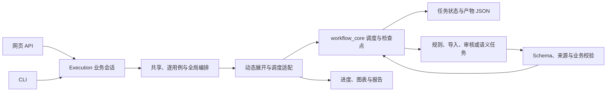

# 代码导览

## 后端入口与数据流

`serve.py → api/application.create_app → workflow/project_service.Workbench`。应用负责装配、生命周期及静态文件；project_routes、execution_routes、result_routes保存HTTP分组，其余专业接口由对应模块注册。

`scene.py → cli/main`提供工作台命令；pipeline/task/evaluate/inspect分派至cli/task_commands。请求结构和业务接口与网页共用。

`workflow/planning.build_pipeline` 安排共享任务，`case_pipeline` 和 `global_pipeline` 分别建立逐用例与全局任务。`engine.Execution` 装配业务会话，`task_registration` 准备输入、选择产物来源并校验，`partition_registration` 注册业务分片，`semantic_executor` 执行模型请求和有限修复。

`workflow_core` 负责任务依赖、并发、暂停、有限重试和持久化。业务适配器处理事件、产物导出、来源记录和故障包。模型层根据供应商诊断调用并发与冷却策略。`pipeline_execution` 驱动动态展开，`publication` 生成业务清单和报告。

逐用例 CRUD 与接口映射可通过项目模型运行配置中的 `agent_evidence_pilot` 启用查证试点，默认关闭。Agent 通过任务证据索引搜索原文，按稳定 ID 和 JSON Pointer 查询记录，并按证据 ID 读取引用。工具结果每次最多 8 条、16 KiB。工具调用和 JSON 文本提交共用权限和模型调用预算。

`domain/contracts`提供稳定的当前协议公共入口；schema_definitions保存JSON业务对象，task_semantics保存显式任务语义版本。版本不由源码字节决定，路径和格式不影响缓存。

## 已有文件输入

- artifact_recognition：确定性识别标准JSON、表格及文件角色。
- artifact_imports：接收文件的公共入口。
- artifact_store：目录索引、不可变版本和用例定位。
- artifact_views：文件、用途和真实引用的只读视图。
- artifact_conversion：有来源的格式转换和目标Schema校验。
- artifact_adoption：确认采用、选择、部分合并与复用记录。
- behavior_imports及reference相关模块：RR/SR定义与时序引用解析。

完整模块迁移表见同目录module-map.json。所有引用统一使用scene_completion.<职责组>，不提供旧Python包路径兼容壳。

## 前端

app组合全局页面。features下每个功能拥有自己的页面、局部组件、控制器与测试。inputs、results、patterns、usage等页面将状态和操作逻辑提取到use*Controller；shared/api统一HTTP错误和地址，shared/types保存跨功能契约。局部状态不通过大型App文件互相隐式调用。

## 运行数据与边界

项目存储路径、任务ID、HTTP与CLI保持原样。.workbench和runs从不随代码迁移；.env与额度账本仅本地保存。旧协议先备份，不提供执行与展示适配。当前v5项目冻结的有效定义、正式产物与审核记录不被重写。
