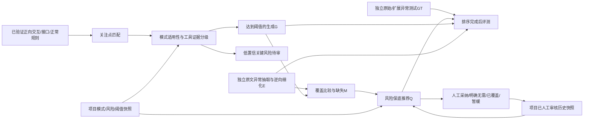

# 细粒度场景与风险保底推荐（2026-10-26）

基线：`c425307`；分支：`codex/scenario-pattern-recommender`。Windows Release保持原样，本轮更新网页和源代码。

## 定义与运行边界

关注点分类沿用项目注册表。**关注点 → 异常模式 → 具体交互上的独立失败条件**；一个关注点可以产生多条场景，一条失败也可以关联多个关注点。

新网页及pipeline默认开启`scenario_patterns=true`；直接调用Execution时可显式关闭以重放旧流程。JSON传输协议保持`scene-workflow-v3`兼容可选元数据，方法规则版本独立升级为`scenario-patterns-recommendation-20261026-v4`。旧项目继续可读；点击运行旧规则项目时新建版本，不覆写旧报告。

推荐节点只依赖M、模式快照及审核历史，不依赖GT。GT整理与测试补全不接收G、模式实例矩阵或推荐排序。共同使用的模式定义和正向约束是方法规则，不能从答案补全。

## 颗粒度和证据

- `pageSize<1`、`pageSize>100`是两条；`-1`、`-2`只是同一失败条件的测试数据，不额外计数。下界/上界的比较方向沿用原始接口规则。
- 请求、返回分开；可选参数未提供正常。凭证未提供同时关联认证与数据完整性时，仅保留一个失败实例，关联关注点/模式列表保留。
- 结构化约束1.0；前提完整且明示业务规则0.85；仅框架提示而前提不足0.6；明确不适用0。**是依据充分性，不是统计概率。**默认阈值0.85。
- 未知格式或阈值不编造。原文明确存在格式校验但缺少具体标准时可为条件级：适用但不可直接执行。框架仅提示撤销、租户等机制而没有前提时不得进G。
- 认证与授权分开。宽泛E“认证失败/权限不足”只覆盖同一实际交互内、已确认适用的对应子模式；保留原分支及宽泛覆盖标签。不能跨人类/Service调用边界，不能用认证覆盖授权。GT仍独立整理，不使用宽泛E的捷径。

## 模式和版本

`scenario_patterns.py`负责确定性实例化；模型继续负责已有的正向正常规则语义抽取，不再重复输出已知数据规则或自评置信度。

模式记录：ID、关联具体关注点、前提、触发模板、所需证据、风险默认值/依据、selector、启用状态、修订及语义定义hash。`custom.`模式按项目声明的正向前提表达式匹配正常规则；结构化内置模式始终使用接口字段的真实约束，不用编辑文本补造阈值。

项目文件：`pattern-settings.json`指向`pattern-versions/<hash>.json`；编辑乐观锁校验expected_version，旧快照不覆盖。运行冻结`run/pattern_settings_used.json`、`recommendation_history_used.json`。设置变化只影响相关模式/生成/比较/推荐，不为无关UI变更重调上游模型。

审核低置信候选必须写明理由；确认适用还须补充正常业务规则，保存项目策略来源。确认本身不声称已准备执行测试数据。新增/停用关注点后需检查关联模式；模式缺项会显示待审，不静默补造模式。

## 排序与历史

`priority=0.7R+0.3H`（项目可改权重，合计1）。R低/普通/高/关键映射0.25/0.5/0.75/1；项目覆盖必须保留理由。一个失败关联多个模式时取适用模式中的最高风险。

H按功能类型、技术特性、实际操作、调用边界、数据方向、明确时效特征的已知特征计算相似度，用Beta(1,1)平滑采纳比例。无历史0.5。不把双方未知特征当作相似证据。同次运行的审核不拿来给本次候选自我背书；先前运行中同一用例的有效人工审核可以复用。模式库版本/具体模式语义定义不兼容的历史不自动复用。

K默认10，先纳入所有满足阈值的关键缺失，再补普通候选；关键超过K允许超出并说明。同分优先多样模式，最终按稳定ID。低置信关键单列待审，不入Q。

仅`human_reviewed=true`且来源为业务审核的`adopt/not_needed`作为历史标签；未审核、暂缓、已覆盖不作负反馈。导入需提供明确来源、审核时间、模式定义hash和上下文。不能把自动GT或未审核机器输出导入为认可历史。网页反馈替换同场景/运行的历史标签，不靠反复点击增加权重。

## 页面与接口

顶栏“模式与风险”：模式搜索、定义编辑/增删/停用、风险依据、证据阈值、K、权重、历史版本和审核历史导入。

“最终结果 → 风险推荐”：按用例查看候选、Q、R/H/置信度、依据、历史来源、关键保底与超K原因；审核低置信关键前提或推荐结果。最终交互对照仍保留E/G/GT同一行及模式/关注点信息。

- GET/PUT `/api/projects/{id}/patterns`（GET可带version）
- GET/POST `/api/projects/{id}/recommendation-history`
- GET `/api/projects/{id}/recommendations?case=...`
- POST `/api/projects/{id}/recommendations/feedback`
- POST `/api/projects/{id}/patterns/review`

原始与扩展GT分别计算：生成有效率`|G∩GT|/|G|`；漏报率`1−|M∩(GT−E)|/|GT−E|`；推荐GT命中率（老师定义采纳率）`|Q∩GT|/|Q|`；误报率`|Q−GT|/|GT|`（可超过100%）；关键缺失召回率`|Q∩关键(GT−E)|/|关键(GT−E)|`。空分母不适用。人工采纳率另列，分母只含人工明确采纳/无需决策，不含暂缓和未审核。

## 验收与成本

冻结重放仅用于检查新粒度、模式适用性、去重、排序与来源隔离；不将旧E/GT或旧配对直接当作新版本正式评测结果。真实定向验收独立保存，保留原始/扩展两套测试指标及未完成状态。

所有账号/模型账本继续保留，未重置。HTTP已发送但响应未知仍保守预留；只有DNS失败/连接拒绝等能确定请求未发送的诊断才释放本次预留，不追溯猜测既有未知扣费。

总括项不与已明示的具体机制重复计数：同一调用已有明确的过期/签名等检查时，“凭证无效”仅作为父模式；已有明确归属/角色/租户规则时，“权限不足”仅作为父模式。具体失败条件分别保留；缺少细分依据时才保留有据的总括条件。原文E的宽泛覆盖标签仍保留，不能据此替代独立GT细化。

## 正向产物跨版本复用

仅允许正向任务。复用需重新核验实际输入、公开Schema、Skill和输出证据，不继承旧E、GT、配对或指标。输入身份忽略文档展示名称；融合SSD中仅忽略已确认用例对应的解释文字及冗余对应引用，仍保留RR/SR全部实际正文、用例ID、组成、约束及确认状态。真实材料或任务指令变化一律重做。空规则结果也须满足同样条件，不能因输出为空或引用校验通过就复用。

## 本轮回归检查

后端337项测试、前端29项测试及TypeScript/Vite构建已通过。冻结正向样本重放覆盖14用例：376个G、140个Q；这是固定正向输入下的粒度与排序回归，不冒充新版本真实模型指标或人工推荐提升。

额外修复：模型生成的用例组ID改为工具按来源顺序规范化，避免相同RR/SR对应因名称漂移重复建模；明确数值边界的本地规则与同一接口约束合并计分，保留两者来源。语义“有效”等约束不能仅因位于JSON字段中就获得1.0分或声称可直接执行。

模式设置现在随项目关注点注册表作用域加载，允许为项目自定义关注点建立模式。保存关联的关注点快照，历史模式版本按原定义读取；修改定义不会悄悄改写旧版本。显式委托给另一服务的正常校验保留为待确认及原始依据，不伪称当前资源服务执行了业务判断。
