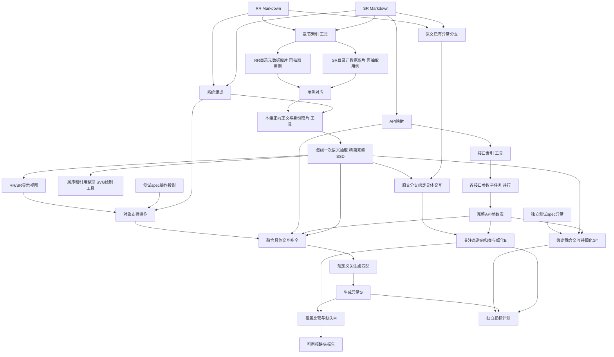

# 实际依赖与可并行任务

图上的用例对应、系统组成完成后，完整SSD即可执行，不等待API映射／参数结束。原文异常分支与正向抽取并行，E和GT的逆向细化只读取各自通道、融合SSD及正常规则，不读取G。

调度器在依赖完成后动态注册用例和接口子任务；每个任务使用独立缓存、审核与修复状态。前端相同依赖层并排布局，不为视觉排列新增依赖。未展开的用例步骤以虚线流程预告展示，不计执行进度。推荐器待定且未启用。
